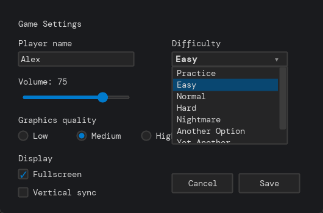
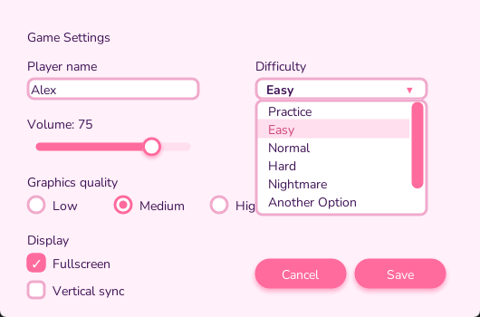
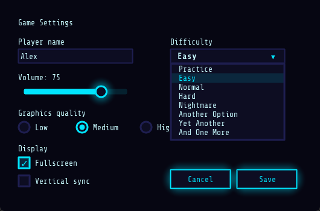
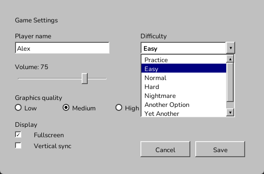
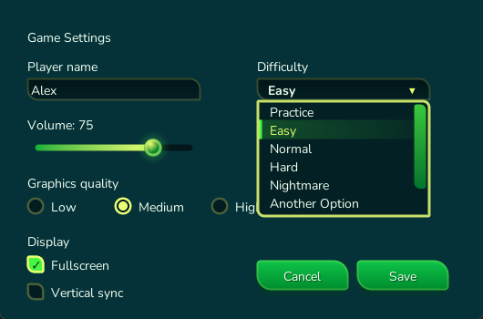
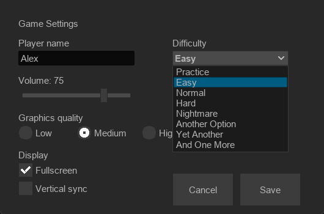

# Setup

Gum Forms gives you a full set of UI controls in code, and a single line restyles **every** control with a built-in theme — so your game's UI can look like any of these without changing a line of control code:

<table><thead><tr><th align="center">DarkPro</th><th align="center">Bubblegum</th><th align="center">Neon</th></tr></thead><tbody><tr><td></td><td></td><td></td></tr></tbody></table>

<table><thead><tr><th align="center">Retro 95</th><th align="center">Forest Glade</th><th align="center">Editor</th></tr></thead><tbody><tr><td></td><td></td><td></td></tr></tbody></table>

This tutorial uses Gum's default visuals to keep the dependency footprint minimal, but you can drop in any of the themes above (or author your own) with one `Apply` call. See the [Themes reference](../../../styling/themes/README.md) for the full gallery and usage.

## Introduction

This tutorial creates a code-only Gum project with a single `Button`, which acts as a starting point for the rest of the tutorials. Only this page depends on your runtime. Once Gum is initialized, the rest of the tutorial series is the same on every runtime.

## Adding Gum to Your Project

Follow the setup page for your runtime through its full program, which ends with a working `Button`:

* [MonoGame/KNI/FNA](../../setup/adding-initializing-gum/monogame-kni-fna/README.md)
* [KNI with Skia](../../setup/adding-initializing-gum/kni-skia.md)
* [raylib (raylib-cs)](../../setup/adding-initializing-gum/raylib-raylib-cs.md)
* [Silk.NET](../../setup/adding-initializing-gum/silk.net.md)
* [BRUTAL](../../setup/adding-initializing-gum/brutal.md)
* [Stride](../../setup/adding-initializing-gum/stride.md)
* [Unity](../../setup/adding-initializing-gum/unity.md)

Then return here to continue.

## Adding a StackPanel

The rest of this tutorial series adds controls to a `StackPanel` named `mainPanel`. Replace the `Button` code from your setup page with the following code, placed right after `GumUI.Initialize` (in Unity, inside `Start`). `AddToRoot` makes `mainPanel` draw and receive input, along with everything added to it.

```csharp
// Initialize
var mainPanel = new StackPanel();
mainPanel.AddToRoot();

// Creates a button instance
var button = new Button();
// Adds the button as a child so that it is drawn and has its
// events raised
mainPanel.AddChild(button);
// Initial button text before being clicked
button.Text = "Click Me";
// Makes the button wider so the text fits
button.Width = 350;
// Click event can be handled with a lambda
button.Click += (_, _) =>
    button.Text = $"Clicked at {System.DateTime.Now}";
```

[Try on XnaFiddle.NET](https://xnafiddle.net/#snippet=H4sIAAAAAAAAA12NSwvCMBCE_8oSPFSQUBQvSg--EA-KaNGLINEsdGmagN34xP9uH6LibWfmm9mHmOVTn4kenzy2BFliUobuKHrirE6QKbJLZdFABBYvsGZ1TCsjaPZ39hPLDeVeGTnQOnYr57iKy4WDZ3b2XR9W4q9adEYJGR3UaBnWl4zxykVz58Ow3R4ZOqYwx1p9oS1pTgqq0w2_Zg1X6DCCYN-CfROiUncm__ONn33UoBge61vOmMmxYowpQ7lwl-f7r3i-AEs5ZmU0AQAA)

<figure><figcaption></figcaption></figure>

## Conclusion

We now have a basic project with a single `Button` in a `StackPanel`. The next tutorial covers the most common forms controls.
