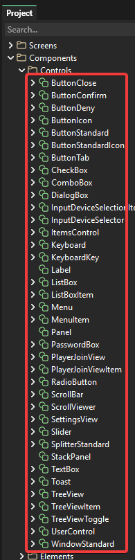

# Setup

## Introduction

This tutorial creates a Gum project with Forms controls and loads it in your game. Only this page depends on your runtime. Once the Gum project loads, the rest of the tutorial series is the same on every runtime.

If you have not yet run the Gum tool, you can get setup instructions in the Gum [Setup page](../../../../gum-tool/setup/).

## Starting From a New Project

The easiest way to start is to let the Gum tool create your game project along with the Gum project:

1. Run the Gum tool. If this is the first time you are running Gum, it shows the New Project dialog. If you have run Gum before, select **File** > **New Project** to open it.
2. Enter a **Project name** such as `MyGame`.
3. Check **Create C# project** and choose your game framework in **Platform**.
4. Leave **Include Forms controls** checked. This adds the Forms controls - the common controls that most projects need like Buttons and TextBoxes.
5. Leave **Include demo screen** checked. Later tutorials reference the demo screen. Don't worry, you can delete this screen later as you develop your game.
6. Click **OK**.

<figure><figcaption>
New Project Window
</figcaption></figure>

Gum creates a runnable game which initializes Gum and loads the Gum project. See [Creating a Project](../../../../gum-tool/setup/creating-a-project.md) for the other options in the dialog.

## Adding a Gum Project to an Existing Game

If you already have a game, follow these steps instead:

1. Add Gum to your game by following the setup page for your runtime in [Adding/Initializing Gum](../../setup/adding-initializing-gum/README.md).
2. Create a Gum project, add it to your .csproj, and load it as shown in [Loading a Gum Project](../../setup/loading-a-gum-project-.gumx.md). When creating the project, leave **Include Forms controls** and **Include demo screen** checked, since later tutorials reference the demo screen.

Your project now includes Forms components.

<figure><figcaption>
Forms Components in Gum
</figcaption></figure>

## Conclusion

Your game now loads a Gum project with Forms components. The next tutorial adds our first screen.
