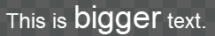

# Gum Features

Gum is a UI toolkit for C# game developers. This page is a tour of what it can do, with each feature linking to its full documentation. To start using Gum, see the [Setup](gum-tool/setup/README.md) page.

### [Design Visually or Write Code](gum-tool/editor-tab.md)

Build your UI in the visual editor, in C# only, or a mix of both.

<figure><figcaption>
The Gum editor
</figcaption></figure>

### [Runs Everywhere](code/about/runtimes.md)

Run the same UI on MonoGame, KNI (including web), FNA, raylib, and SkiaSharp hosts such as WPF, .NET MAUI, and Stride, on desktop and mobile, with an editor for Windows, macOS, and Linux.

<figure><figcaption>
Gum UI in game
</figcaption></figure>

### [Full UI Controls, Themed](code/controls/README.md)

Use ready-made controls such as Button, ListBox, TextBox, and Slider, restyle them with a built-in theme or your own styles, and operate them with a mouse, touch screen, keyboard, or gamepad.

<figure><figcaption>
Forms controls
</figcaption></figure>

### [Live Preview](gum-tool/editor-tab.md#preview)

Open any screen or component in its own window running the real runtime, where buttons click, lists scroll, and text boxes take input.

<figure><figcaption>
A screen shown in Preview
</figcaption></figure>

### [Variable References](gum-tool/gum-elements/general-properties/variable-references.md)

Point any variable at another variable, like a spreadsheet formula, to keep sizes and colors consistent across a project.

<figure><figcaption>
Height set to follow Width
</figcaption></figure>

### [Components with Has-A and Is-A](gum-tool/gum-elements/component/README.md)

Build a component once and place customized instances of it inside other components, or extend it with a base type and expose the variables each instance can change.

<figure><figcaption>
Components in a Gum project
</figcaption></figure>

### [States and Animations](gum-tool/gum-elements/states/README.md)

Save sets of variable values as named states, then switch between them or animate between them on a timeline.

<figure><figcaption>
States in a category
</figcaption></figure>

### [Layouts That Adapt](gum-tool/gum-elements/general-properties/x-units.md)

Position and size objects in pixels, percentages, or relative to their children, then stack, wrap, or arrange them in a grid so the layout fits any resolution.

<figure><figcaption>
Position and size units
</figcaption></figure>

### [Gradients, Drop Shadows, and Rounded Rectangles](gum-tool/gum-elements/rectangle.md)

Draw rectangles and circles with fills, outlines, gradients, drop shadows, and rounded corners.

<figure><figcaption>
Rectangles with outline, corner radius, and gradient
</figcaption></figure>

### [Shaders and Effects](code/standard-visuals/containerruntime.md#render-target-shaders-rendertargeteffect)

Render a container to its own texture, then fade, blend, or mask it or apply a shader to everything inside it at once.


**TODO:** Screenshot of a container with a shader applied.


### [Vector or Raster Art](gum-tool/gum-elements/skia-standard-elements/README.md)

Show sprites and NineSlice panels from image files, or SVG and Lottie vector art through SkiaSharp.

<figure><figcaption>
An Svg instance
</figcaption></figure>

### [Rich Text and Fonts](code/standard-visuals/textruntime/bbcode.md)

Style individual words with BBCode tags, and generate fonts at runtime from a font name and size.

<figure><figcaption>
Text sized with a BBCode tag
</figcaption></figure>

### [Localization](gum-tool/localization.md)

Link a CSV or RESX file to your project and switch languages in the editor to check how longer text fits your layout.

<figure><figcaption>
Localization files and language selection
</figcaption></figure>

### [Hot Reload](code/debugging/hot-reload.md)

Save a change in the editor and watch your running game update without a restart.


**TODO:** Screenshot of a game and the editor side by side.


### [Full Code Generation](gum-tool/code-tab/README.md)

Generate C# classes for your screens and components so your code works with typed properties instead of strings.

<figure><figcaption>
Generated code in the Code tab
</figcaption></figure>

### [Binding and MVVM](code/binding-viewmodels/README.md)

Bind controls to a view model so your UI stays in sync with your game data.

<figure><figcaption>
A settings screen bound to a view model
</figcaption></figure>

### [Native AOT Ready](code/performance-and-optimization/native-aot-and-trimming.md)

Publish with Native AOT or trimming after converting your project to the JSON file format.


**TODO:** Screenshot of a Native AOT published game.


### [Infinitely Customizable](code/styling/code-only-styling/adding-and-removing-visual-children.md)

Replace the visuals behind any control, down to adding your own renderable types, when styling is not enough.


**TODO:** Screenshot of a control with a replaced background.


### [Tooling](cli/README.md)

Create projects, check for errors, and generate code from the command line with GumCli, extend the editor with plugins, and give an AI assistant the Gum documentation.


**TODO:** Screenshot of GumCli output.

