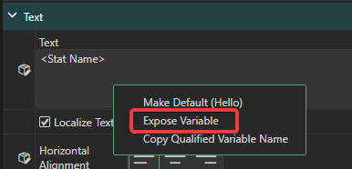
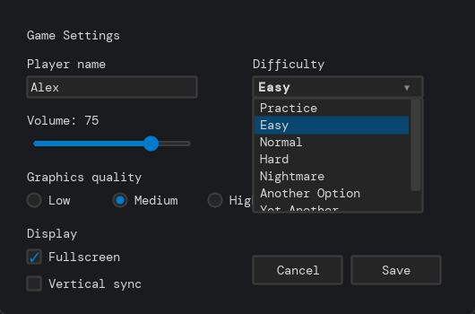
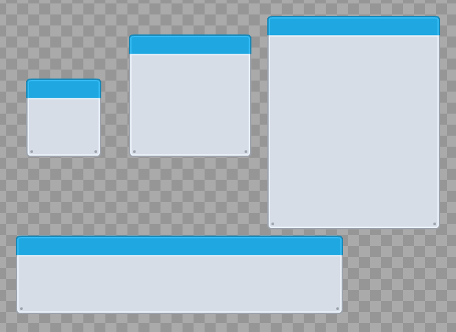

# Gum Features

## Introduction

Gum is a UI toolkit for C# game developers. You design screens and components in a visual editor, then run them in your game on MonoGame, KNI, FNA, raylib, or SkiaSharp, or skip the editor and build everything in code. This page is a tour of what Gum can do, with a link on each feature to its full documentation.

To start using Gum, see the [Setup](gum-tool/setup/README.md) page.

### [Visual Editor](gum-tool/editor-tab.md)

Design your UI in a what-you-see-is-what-you-get editor that runs on Windows, macOS, and Linux.

<figure><figcaption>
The Gum editor
</figcaption></figure>

### [Preview with Real Controls](gum-tool/editor-tab.md#preview)

Open any screen or component in its own window running the real runtime, where buttons click, lists scroll, and text boxes take input.


**TODO:** Screenshot of the Preview window.


### [Position and Size Units](gum-tool/gum-elements/general-properties/x-units.md)

Position and size objects in pixels, percentages of their parent, or relative to their children to build layouts that adapt to any resolution.

<figure><figcaption>
Position and size units
</figcaption></figure>

### [Stacking and Wrapping](gum-tool/gum-elements/container/children-layout.md)

Stack children in rows or columns, and wrap them onto new lines, without positioning each one by hand.

<figure><figcaption>
Children Layout options on a Container
</figcaption></figure>

### [Grid Layout](code/layout/grid.md)

Place children in a grid of equal-sized cells.

<figure><figcaption>
Buttons arranged in a 3x3 grid
</figcaption></figure>

### [Reusable Components](gum-tool/gum-elements/component/README.md)

Build a component once, then place and customize instances of it in any screen or in other components.

<figure><figcaption>
Components in a Gum project
</figcaption></figure>

### [Inheritance](gum-tool/gum-elements/general-properties/base-type-inheritance.md)

Pick a **Base Type** to make one component extend another and inherit its instances and variables.

<figure><figcaption>
Base Type on an instance
</figcaption></figure>

### [Exposed Variables](gum-tool/gum-elements/component/exposed-variables.md)

Expose a variable on a component so each instance can set its own value, such as a label's text.

<figure><figcaption>
Exposing the Text variable
</figcaption></figure>

### [States](gum-tool/gum-elements/states/README.md)

Save sets of variable values as named states, such as Enabled, Disabled, or OffScreen, and switch between them in the editor or in code.

<figure><figcaption>
States in a category
</figcaption></figure>

### [Animations](gum-tool/tutorials-and-examples/animation-tutorials/README.md)

Animate between states on a timeline in the editor, then play the animation from your game.


**TODO:** Screenshot of the **Animations** tab.


### [Variable References](gum-tool/gum-elements/general-properties/variable-references.md)

Point any variable at another variable, like a spreadsheet formula, to keep sizes and colors consistent across a project.

<figure><figcaption>
Height set to follow Width
</figcaption></figure>

### [Forms Controls](code/controls/README.md)

Use ready-made Button, CheckBox, ListBox, ComboBox, TextBox, Slider, ScrollViewer, TabControl, and other controls that handle input and state changes for you.

<figure><figcaption>
A ListBox with a scroll bar
</figcaption></figure>

### [Themes](code/styling/themes/README.md)

Restyle every Forms control with one line of code by applying a built-in theme.

<figure><figcaption>
The DarkPro theme
</figcaption></figure>

### [Binding and MVVM](code/binding-viewmodels/README.md)

Bind controls to a view model so your UI stays in sync with your game data.

<figure><figcaption>
A settings screen bound to a view model
</figcaption></figure>

### [Mouse, Touch, Keyboard, and Gamepad](code/events-and-interactivity/gamepad-support.md)

Navigate and interact with the same controls using a mouse, a touch screen, a keyboard, or a gamepad.


**TODO:** Screenshot of a focused control.


### [Code Generation](gum-tool/code-tab/README.md)

Generate C# classes for your screens and components so your code works with strongly typed properties instead of strings.

<figure><figcaption>
Generated code in the Code tab
</figcaption></figure>

### [Code-Only UI](code/getting-started/tutorials/code-only-gum-forms-tutorial/README.md)

Skip the editor entirely and build your UI in C#.

<figure><figcaption>
A label created in code
</figcaption></figure>

### [Hot Reload](code/debugging/hot-reload.md)

Save a change in the editor and watch your running game update without a restart.


**TODO:** Screenshot of a game and the editor side by side.


### [Localization](gum-tool/localization.md)

Link a CSV or RESX file to your project and switch languages in the editor to check how longer text fits your layout.

<figure><figcaption>
Localization files and language selection
</figcaption></figure>

### [Runtime Fonts](code/files-and-fonts/fonts.md)

Generate fonts at runtime from a font name and size so you do not have to build bitmap fonts by hand.


**TODO:** Screenshot of text in several fonts and sizes.


### [Rich Text](code/standard-visuals/textruntime/bbcode.md)

Style individual words with BBCode tags for color, size, font, bold, italic, and outline.

<figure><figcaption>
Text sized with a BBCode tag
</figcaption></figure>

### [Shapes](gum-tool/gum-elements/shape-properties/README.md)

Draw circles and rectangles with fills, outlines, gradients, and drop shadows.

<figure><figcaption>
A shape with a gradient
</figcaption></figure>

### [NineSlice](gum-tool/gum-elements/nineslice/README.md)

Stretch a panel or button texture to any size while its corners stay crisp.

<figure><figcaption>
A NineSlice resized to different dimensions
</figcaption></figure>

### [Render Targets](gum-tool/gum-elements/container/is-render-target.md)

Render a container to its own texture to fade, blend, or mask its children as a group.


**TODO:** Screenshot of a container with partial alpha.


### [SVG and Lottie](gum-tool/gum-elements/skia-standard-elements/svg.md)

Draw resizable SVG vector art and Lottie animations through SkiaSharp.

<figure><figcaption>
An Svg instance
</figcaption></figure>

### [Many Runtimes](code/about/runtimes.md)

Use the same Gum project on MonoGame, KNI, FNA, raylib, and SkiaSharp-based hosts such as WPF, .NET MAUI, Silk.NET, and Stride.

<figure><figcaption>
Gum UI in game
</figcaption></figure>

### [GumCli](cli/README.md)

Create projects, check for errors, generate code, and render screenshots from the command line or a build pipeline.


**TODO:** Screenshot of GumCli output.


### [Plugins](gum-tool/plugins/README.md)

Extend the editor with plugins written as ordinary .NET class libraries.


**TODO:** Screenshot of the **Plugins** menu.


### [AI Assistant Support](ai/README.md)

Connect an AI assistant to the live Gum documentation, and give it GumCli and skills to generate and verify UI.


**TODO:** Screenshot of an assistant using the Gum documentation.

