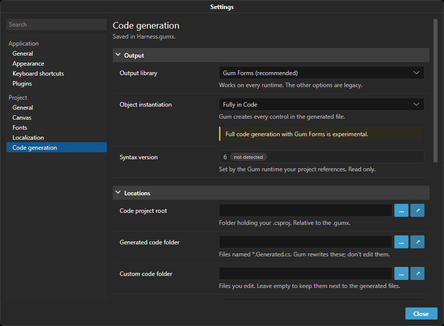
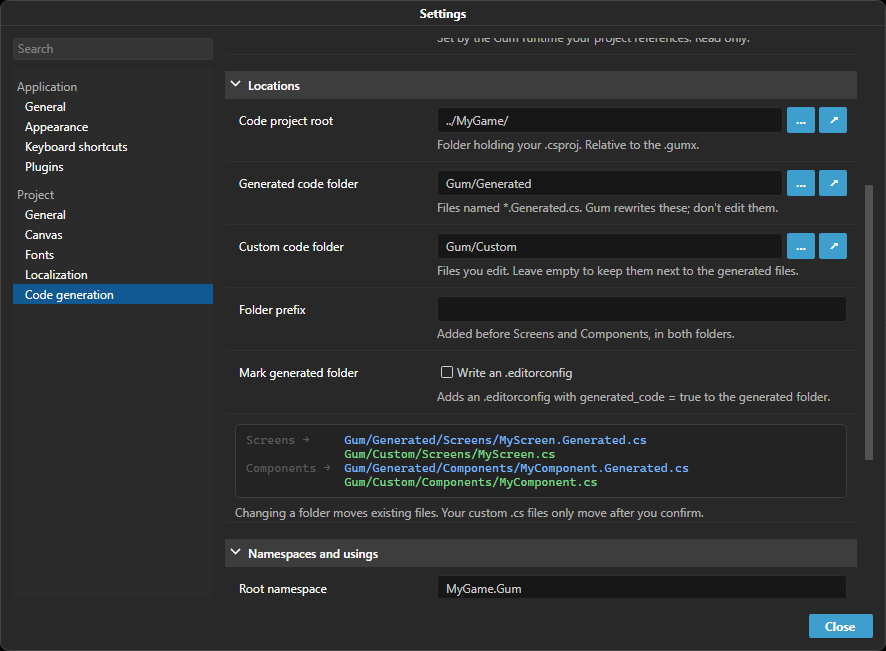
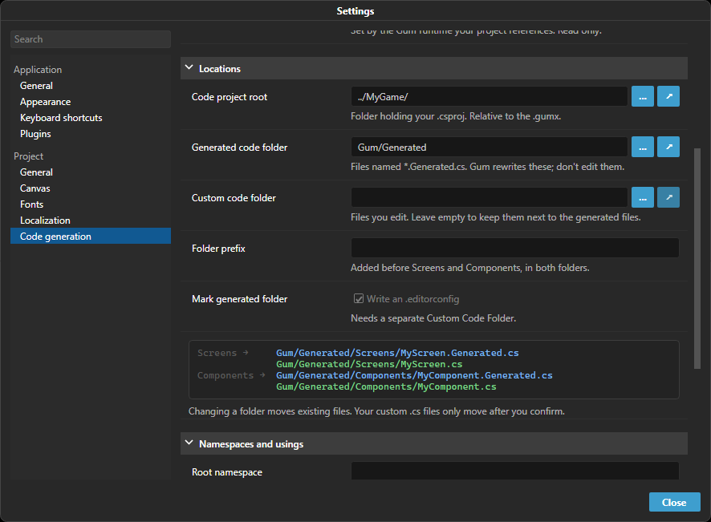

# Code Tab

## Introduction

The Code tab shows the C# that Gum generates for the selected Screen or Component, and saves it to your game project. The tab is available when a Screen or Component is selected.

This tab provides the following functionality:

* Immediate display of generated code for the selected object, instance or state
* A **Generate** button that writes code files to your game project
* The code generation settings for the selected element

The settings that apply to the whole project (where files go, namespaces, output library) are on the **Code generation** page of **Edit > Settings...**. The **Edit project settings...** link in the Code tab opens that page.

## Viewing Generated Code

The Code tab displays code for whatever is selected and updates as you edit. It displays code even if you never set up code generation, so you can use it to see how to reproduce a layout in code. The **Object** and **State** buttons above the preview choose between the whole object and only the selected state (see [Generation Scope](generation-scope.md)).

## Previewing Instances

If you have a single instance selected, the preview window displays the code for creating the instance and assigning its variables. This is especially useful if you are unsure how to reproduce a particular layout in code. For example, the following image shows the generated code for a Text named TextInstance.

<figure><figcaption><p>Generated code for a Text named TextInstance</p></figcaption></figure>

The generated code shows all of the assignments necessary to reproduce the current instance's layout. Keep in mind that only explicitly-set variables are displayed. Any default variables (variables which appear with a green background in the Variables tab) are not assigned in generated code.

## Previewing Entire Screens and Components

If a Screen or Component is selected, then an entire class for the component is displayed in the preview window. This generated code includes:

* `using` statements
* A `partial` class named after the Screen or Component
* Inheritance depending on the output library and base type
* `enum` declaration for all categories
* Properties for each category including switch statements assigning all properties for each state
* A property for each instance in the Screen or Component
* Initialization of all variables including variables on the instances if using full code generation

## Setting Up Code Generation

Code generation writes files into your game project, so back up the project or commit it to source control first.

The first time you select a Screen or Component in a project that has no Code Project Root, the Code tab asks how to set up:

* **Auto** looks for a `.csproj` (or `.shproj`, `.vbproj`, `.fsproj`) in the folder of your Gum project and the folders above it. It then fills in the Code Project Root, the Root Namespace (from the project file), the Output Library (**Gum Forms**) and the Object Instantiation Type (**Reference Loaded Gum Project**). If it finds no project file, Gum says so and changes nothing, so save your Gum project in a subfolder of the folder containing your `.csproj`.
* **Manual** dismisses the prompt and shows the settings so you can fill them in yourself, starting with the Code Project Root.

The prompt does not appear if no project file exists above the Gum project. Either way, you can change every value later on the **Code generation** page of **Edit > Settings...**. Settings are saved in `ProjectCodeSettings.codsj` next to your Gum project, and `gumcli codegen` reads the same file (see [codegen](../../cli/codegen.md)).

<figure><figcaption><p>The Code generation page of the Settings window</p></figcaption></figure>

For a step-by-step walkthrough in a MonoGame/KNI/FNA game, see the [tutorial on setting up code generation](../../code/getting-started/tutorials/gum-project-forms-tutorial/gum-screens.md). FlatRedBall projects handle code generation in the FlatRedBall Editor.

Once a Code Project Root is set, click **Generate** to write files. The **Selected** and **All** buttons next to it choose between the selected element and every element in the project. If an element references components that have no code files yet, Gum generates those too. Each element also has a **Generation Behavior** (see below) which controls whether Gum writes its code automatically.

The **Code generation** page groups the project-wide options into three sections: **Output** (Output Library, Object Instantiation Type, Syntax Version), **Locations** (Code Project Root, Generated Code Folder, Custom Code Folder, Folder Prefix, Mark Generated Folder) and **Namespaces and usings** (Root Namespace, Append Folder to Namespace, Default Screen Base, Project-wide Usings). Projects using a legacy output library (Xamarin, WPF, Maui) also get a collapsed section for the options only those use. Every option has a one-line hint under it. **Syntax Version** is read-only; its hint says where the version was detected from.

## Folder Layout

Every Screen and Component produces two files that together make one `partial` class:

* `MyScreen.Generated.cs` is the **generated** file. Gum rewrites it every time it generates, so do not edit it. Deleting it loses nothing, because Gum can recreate it.
* `MyScreen.cs` is the **custom** file. Gum writes it once as a stub with an empty `partial void CustomInitialize()`, then leaves your code alone. The generated constructor calls `CustomInitialize()`, so this is where your code goes.

Both files go under the Code Project Root. Screens go in a `Screens` folder, Components in a `Components` folder, and the folders you created in the Gum project are mirrored inside them:

```
<Code Project Root>/
  Screens/
    MainMenu.Generated.cs
    MainMenu.cs
  Components/
    Buttons/
      IconButton.Generated.cs
      IconButton.cs
```

Three settings change this layout:

* **Generated Code Folder** puts the generated files in a subfolder of the Code Project Root.
* **Custom Code Folder** puts the custom files in a different subfolder, so generated and custom files are separated. The `Screens` and `Components` layout is repeated under both folders.
* **Folder Prefix** is text added in front of the `Screens` and `Components` folder names, in both folders.

The **Resolves to** box on the Code generation page shows where a Screen and a Component will be written for the current settings, so you can check a change before generating.

<figure><figcaption><p>Generated and custom files in separate folders, with the Resolves to box showing where each file goes</p></figcaption></figure>

Namespaces come from the Gum project, not from where the files are on disk. A component in the Gum folder `Buttons` gets the namespace `<Root Namespace>.Components.Buttons` (with **Append Folder to Namespace** on) wherever its files are. Both halves of a class share one namespace, so changing a folder setting never changes a namespace.

## When a Folder Setting Changes

Changing the Output Library, Code Project Root, Generated Code Folder, Custom Code Folder or Folder Prefix changes where files belong. Gum then lists the files it would move, and nothing changes until you click **Migrate**. On Migrate, Gum moves your existing generated and custom files to their new locations, regenerates the affected elements, and removes folders the move left empty. Gum never deletes a custom file that contains your code; it moves it.

Before changing anything, Gum keeps a copy of every file the migration touches (the newest ten migrations per project). **Content > Restore Last Code File Migration** puts those files back. It never overwrites a file you edited after the migration.

If you click **Cancel**, or move files by hand, the files left at the old location appear as [orphaned code files](orphaned-code-files.md), and **Content > Migrate Code Files** offers the same migration at any time. If you already moved a custom file into the new location yourself, Gum finds it there and does not create a second one.

Changing the Root Namespace, Append Folder to Namespace or [Inheritance Location](inheritance-location.md) does not move files. Gum lists the custom files whose `namespace` or class declaration no longer matches and rewrites them in place after you confirm. These rewrites are backed up too, so the same Restore menu item undoes them.

Renaming or moving an element in Gum renames or moves its code files to match. See [Orphaned Code Files](orphaned-code-files.md) for renames, deletes and leftover files.

## Settings Reference

### Code Project Root

The location of the folder containing the .csproj file. Gum writes the `Screens` and `Components` folders here, or inside the Generated Code Folder and Custom Code Folder if you set them. Leave it empty to turn off writing code files.

Gum also reads the .csproj in this folder to detect which version of the Gum runtime your game references, so keep this pointed at the .csproj folder. To put code files somewhere else inside the project, use Generated Code Folder.

If this folder has several .csproj files, Gum reads `Assembly-CSharp.csproj` first, then the one with the shortest name. To use a different .csproj, set `CsprojPath` in `ProjectCodeSettings.codsj` to its path relative to the project file (.gumj or .gumx), for example `"CsprojPath": "../MyGame.Ui.csproj"`.


The `CsprojPath` setting is available in October 2026, or now if building Gum from source.


### Generated Code Folder

An optional folder, relative to the Code Project Root, that holds the generated files. For example, `Gum/Generated` writes a component named Button to `<Code Project Root>/Gum/Generated/Components/Button.Generated.cs`. Leave it empty to generate directly in the Code Project Root.

This setting only moves files. Namespaces are still built from the Root Namespace and the element's folder in the Gum project.

If you enter an absolute path, Gum saves it as a path relative to the Code Project Root so generation works wherever the project is cloned. Moving your Gum project to a new location can break a relative path, so update it if you move the project.

### Custom Code Folder

An optional folder, relative to the Code Project Root, for your own code files (`Button.cs`). The generated files (`Button.Generated.cs`) stay in the Generated Code Folder, so tools that skip generated folders, such as analyzers, diffs and refactorings, can ignore them. Leave it empty to keep each custom file beside its generated file.

The `Screens`, `Components` and Gum folder layout is mirrored under both folders, so `Components/Buttons/IconButton` is `<Generated Code Folder>/Components/Buttons/IconButton.Generated.cs` and `<Custom Code Folder>/Components/Buttons/IconButton.cs`. The Folder Prefix applies to both. See [When a Folder Setting Changes](#when-a-folder-setting-changes) for what happens to existing files.

### Folder Prefix

Text put in front of the `Components` and `Screens` folder names. Leave it empty to use `Components` and `Screens`.

* A prefix ending in a slash, such as `GumCodeGen/`, puts both folders inside a folder with that name: `GumCodeGen/Components/Button.Generated.cs` and `GumCodeGen/Screens/MainMenu.Generated.cs`.
* A prefix without a slash, such as `Gum`, renames the folders: `GumComponents/Button.Generated.cs` and `GumScreens/MainMenu.Generated.cs`.

The prefix is applied inside the Generated Code Folder and the Custom Code Folder (or the Code Project Root if a folder is empty). `StandardElements.Generated.cs` stays directly in the output folder. Like the folder settings, the prefix only moves files; it does not change namespaces.

### Mark Generated Folder

Off by default. When on, Gum writes an `.editorconfig` into the Generated Code Folder containing `generated_code = true` for `*.cs`, marking the whole folder as generated code. Gum already names generated files `*.Generated.cs`, which the C# compiler's analyzers treat as generated by file name, so this option is only for when you want the folder itself marked.

The option is available only when the Generated Code Folder is its own folder, so the file never marks your own code. The Generated Code Folder must be set and differ from the Code Project Root, the Custom Code Folder must be set and differ from the Generated Code Folder, and the Custom Code Folder must not be inside it. When one of these is missing, the row is disabled and its hint names the missing condition.

<figure><figcaption><p>Mark Generated Folder is disabled until the Custom Code Folder is a separate folder</p></figcaption></figure>

Gum only manages a file that starts with its own `# Written by Gum.` comment. If the generated folder already has another `.editorconfig`, Gum leaves it as it is and says so in the Output tab (or in the `gumcli codegen` output). Gum also leaves alone a file it wrote if you have edited it. Turning the option off or changing the Generated Code Folder removes the file Gum wrote, unless you edited it.

### Output Library

New projects use **Gum Forms (recommended)** regardless of the runtime. Change the Output Library only if you need one of the deprecated options below.

* **Gum Forms (recommended)** is the preferred code generation. It works with MonoGame, KNI, FNA, Skia, Raylib, Silk.NET, Stride, and Unity. This code generation generates code with classes containing properties which inherit from FrameworkElement such as Button and Textbox wherever possible. If a non-forms instance (such as a Sprite or Text instance) is added to a screen or component, then code will _fall back_ to generating non-forms properties (such as SpriteRuntime or TextRuntime).
* **MonoGame (deprecated)** generates code without creating forms controls. Use this if your game does not use Forms, or if your game predates Forms support in MonoGame.
* **SkiaSharp (deprecated)** generates code without creating forms controls, for runtimes which use SkiaSharp for graphics. Prefer **Gum Forms (recommended)**, which also works on Skia.
* **Raylib (deprecated)** generates code for projects using the Raylib runtime. Raylib code generation currently supports only the **Reference Loaded Gum Project** instantiation type (see below); the **Fully in Code** type is not yet supported and Gum displays a warning if you select it.
* **Silk.NET (deprecated)** generates code for projects using the Gum.SilkNet runtime. Like Raylib, it currently supports only the **Reference Loaded Gum Project** instantiation type; the **Fully in Code** type is not yet supported and Gum displays a warning if you select it.


The **Raylib** Output Library is available in the Gum July 2026 release and newer. The **Silk.NET** Output Library is available in the Gum August 2026 release and newer.


Additional libraries may be added in the future. If your project needs support for code generation and you are using a library that is not supported, please contact the Gum team on Discord or GitHub.

### Object Instantiation Type

This option controls how much code is generated by Gum. The following options are available:

#### Reference Loaded Gum Project

This generates minimal code for access to objects. Specifically this generates:

* Instantiation of Screens and Components using a strongly-typed class
* Access to instances through strongly typed property names
* Setting of states through enums

This approach allows for the customization of Gum files without requiring full code regeneration. Games which use this type of code generation can still support modding, so long as the modified files do not remove instances or change their names. This type of code generation still requires the loading of the Gum project (.gumj or .gumx and associated files).

#### Fully in Code


Full code generation with Gum Forms is experimental. Gum shows a warning on the setting.


This option enables working in Gum to create layouts which will work fully in code without loading a .gumj file. This is especially important if you are working on a platform with limited IO access. Generated code can run faster than loading a .gumj file since it does not require file IO, XML parsing, and reflection.

For more details see the [Runtime Generation Details](runtime-generation-details.md) page.

### Project-wide Using Statements

Add the following using statement at the end of the Project-wide Using Statement box so that references to standard runtime types are found.

```csharp
using Gum.GueDeriving;
```

If you plan on creating Screens, you should also add using statements for your component runtimes

```csharp
using {YourProjectNamespace}.Components;
```

### Root Namespace

Enter the project's Root Namespace, such as `MyGame`. Gum prefixes the generated code namespace with this entered namespace.

### Append Folder to Namespace

This option controls whether the folder names of screens and components should be added to a namespace.

For example, consider a component named ButtonStandard inside the Components/Controls folder. If this option is checked (recommended), then the class is generated with the `Controls` folder included in the namespace:

```csharp
namespace MyProject.Components.Controls;
```

If this option is unchecked, then folders are not included in the namespace, so the generated code would include the following namespace:

```csharp
namespace MyProject.Components;
```

### Default Screen Base

Enter the type that you would like all screen runtimes to inherit from. If you're not sure what to enter, then use `Gum.Wireframe.GraphicalUiElement`. If your game uses a custom class that you have written for all screens, then use the name of that class. You can switch to custom classes later as your project grows.

Note that Gum may choose to override this base class in certain conditions including:

* If your project is using Forms
* If your screen inherits from another screen

### Generation Behavior

This controls when Gum generates code for a component.

* NeverGenerate - generated code is not saved for this element, and Gum leaves its existing code files alone
* GenerateManually - generated code is only saved for this element if the **Generate Code** button is clicked, or if it is a requirement for another component or screen which is generated.
* GenerateAutomaticallyOnPropertyChanged - this is generated whenever a change is made to this element in Gum.
