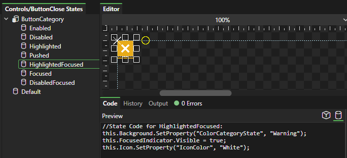

# Generation Scope

### Introduction

The **Object** and **State** buttons above the code preview control whether the preview shows the entire selected object or only the selected state. This only changes the preview; the files Gum saves to disk always contain the whole element.

If **Object** is selected, then the entire object's generated code is displayed.

<figure><figcaption>
Selected Object option results in the entire element's code being generated
</figcaption></figure>

The **State** button is useful if you would like to see only the changes made by the selected state.

<figure><figcaption>
Selected State option displays only the current state
</figcaption></figure>

The **Selected** and **All** buttons next to the **Generate** button are a separate choice: they decide whether **Generate** writes files for the selected element or for every element in the project.
