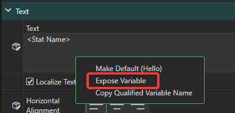

# Exposed Variables

Exposing a variable on an instance inside a component makes it a variable of the component itself, so each instance of the component can set its own value. Variables that are not exposed stay hidden on component instances.

Expose a variable when each use of the component needs a different value, such as the text of a label or the visibility of a button inside it.

To expose a variable:

1. Select an instance inside the component.
2. Right-click the variable in the **Variables** tab and select **Expose Variable**.
3. Enter a name for the new variable.

The variable now appears on the component, and the original row shows **Exposed as** followed by the new name. Instances of the component set it like any other variable.

To remove an exposed variable, right-click the original variable and select **Un-expose Variable**.

<figure><figcaption>
Expose Variable in the right-click menu
</figcaption></figure>
