# 1 - The Basics

## Introduction

This page walks you through the basics of using the _Gum UI tool,_ which we'll refer to simply as Gum for this tutorial series.

<figure>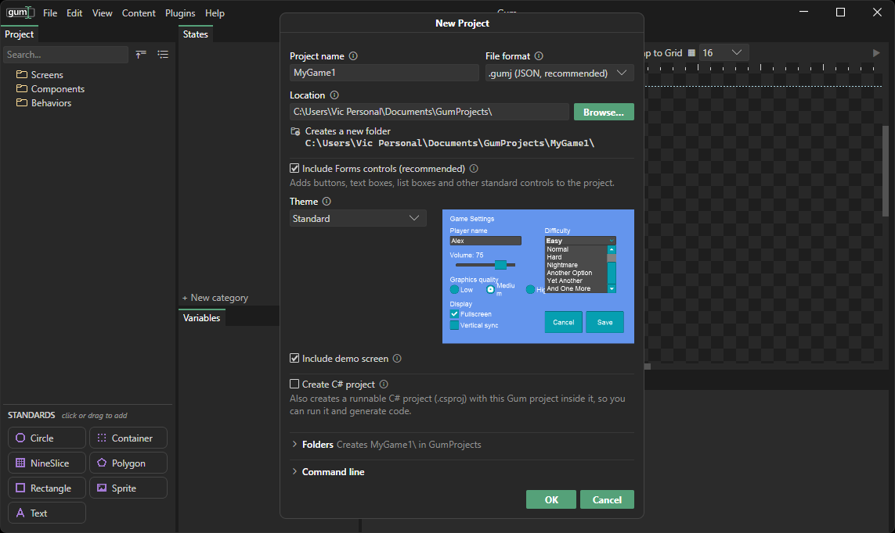<figcaption>
Gum tool with New Project window open
</figcaption></figure>

### Creating a Project

Before we begin looking at the Gum tool, we'll create a new project. If this is the first time you are running Gum, the New Project window opens automatically. To create a new project:

1. Enter a name for your project
2. Select a location for your project
3. Keep the forms and demo screen options selected
4. Select a theme - this tutorial series uses the Standard theme, but you are free to use a different theme. If you choose a different theme, there will be some differences between your selected theme and the tutorial screenshots.
5. Leave **Create C# project** unchecked
6. Click OK

<figure>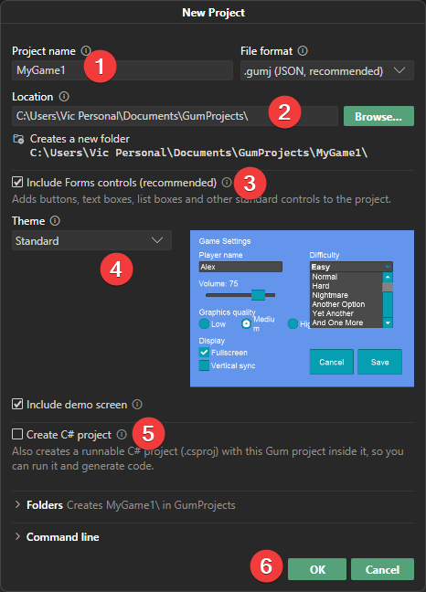<figcaption>
Enter or confirm options when creating a new project
</figcaption></figure>


Create C# project also creates a runnable game project that contains your Gum project. This series does not cover working with that project.


After you click OK, your project should contain screens, components, and behaviors

<figure>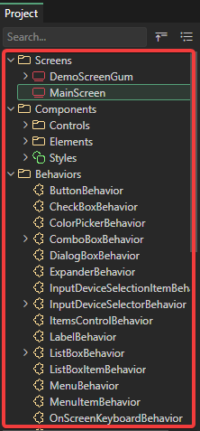<figcaption>
Screens, Components, and Behaviors after creating a new project
</figcaption></figure>

The Project tab lists your Screens, Components, and Behaviors as folders. We'll use it throughout this tutorial series. For everything the Project tab does, see [Project Tab](../../project-tab.md).

The examples in this series use a blank screen named MainScreen, which a new project does not contain.

1. In the Project tab, right-click the **Screens** folder and select **Add Screen**.
2. In the **Add Screen** dialog, type `MainScreen` and click **OK**.

A MainScreen item now appears under **Screens** in the Project tab.

### Gum Elements

Gum separates its elements into a few categories: Screens, Components, Behaviors, and Standards.&#x20;

Let's take a look at each of the different types.

### Screens

Screens are objects which can contain standard elements and instances of other components. Screens cannot be added to other Screens and are considered _top level_ objects. Screens exist mainly for organization. Screens can be simple, such as a loading screen, or complex such as a HUD in an RTS game.

Your game includes DemoScreenGum which shows how controls can be created and laid out.

<figure>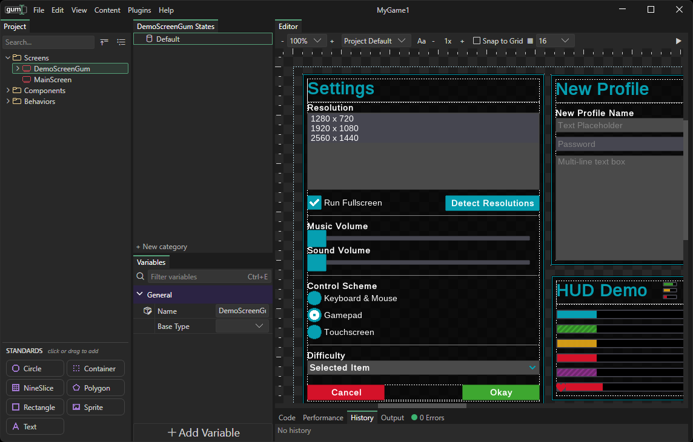<figcaption>
DemoScreenGum with default controls
</figcaption></figure>

### Components

Components are objects which can contain standard elements and instances of other components. Components can be very simple, such as a Label, or very complex, such as an options menu with dozens of _instances_. Items added to components or screens are called _instances_.

<figure>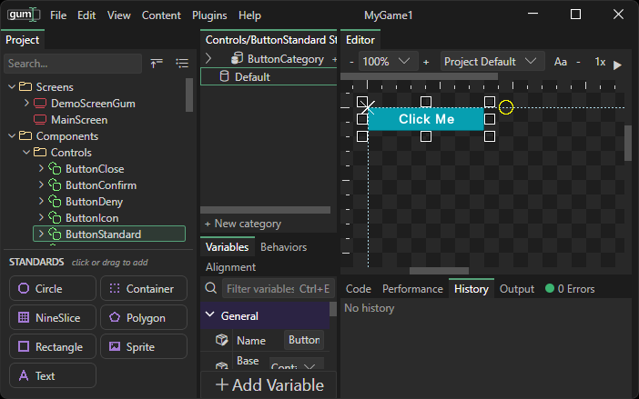<figcaption>
ButtonStandard component in the Controls folder
</figcaption></figure>

Components and screens are similar - both can contain instances of standard elements, and both can contain other components. The only difference between screens and components is that screens cannot contain other screens.

For example you can think of screens in a video game which might include a main menu, credits screen, options screen, and level selection screen. You can think of components as elements which are composed of multiple standard elements. Examples include a Button component which is made up of a Sprite instance and a Text instance, or a Logo component which may be made up of multiple Sprites and Text objects.

### Behaviors

Behaviors are sets of requirements, such as required states and instances, that let Gum treat a component as a Forms control like a Button. Adding Forms controls to your project also adds their behaviors, so this series does not cover creating or editing them. For more, see [Behaviors](../../gum-elements/behaviors/README.md).

### Standard Types

* .png>) \
  Circle - a circle which can be filled in, outlined, or both. Often used for visualizations or for defining collision in your Gum objects for a game.
* .png>) \
  Container - invisible object used to contain other objects. These are used to provide margins, change layouts (such as vertical vs horizontal stacking), and to organize your UI.
* .png>) \
  NineSlice - visual object which uses nine sprites to create a resizable object from a source PNG (or portion of a PNG). The corner sprites (4) are not resized. The top, bottom, left, and right sprites are stretched on one axis. The middle sprite stretches both horizontally and vertically. These are used to create resizable frames.
* .png>) \
  Polygon - polygon outline which can have any number of points. These are usually not used for UI, but can be used if you are defining collision in your Gum objects for a game.
* .png>) \
  Rectangle - a rectangle which can be filled in, outlined, or both. Used for solid-colored backgrounds, frames, blocking out a UI, or for defining collision in your Gum objects for a game.
* .png>) \
  Sprite - a visual object which displays a source PNG (or a portion of a PNG). These are used for icons, backgrounds, and other visual objects which are usually not resized dynamically.
* .png>) \
  Text - a visual object which can display characters. These are used for any situation where text needs to be displayed such as labels and paragraphs.


Plugins can add additional standard elements. The list above is the default list of standard elements before plugins have made any changes.


### Previewing your Project

Gum lets you project in a real game by clicking the preview button at the top right of the editor tab.

<figure>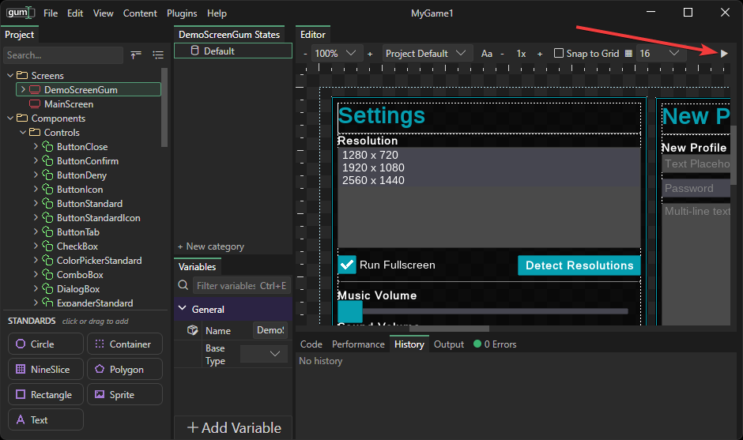<figcaption></figcaption></figure>

The selected screen or component is displayed in the preview window. This preview is a live game running, so all controls react to cursor events. This preview lets you easily test whether your controls are behaving as expected, including any styling changes that you might make.

<figure>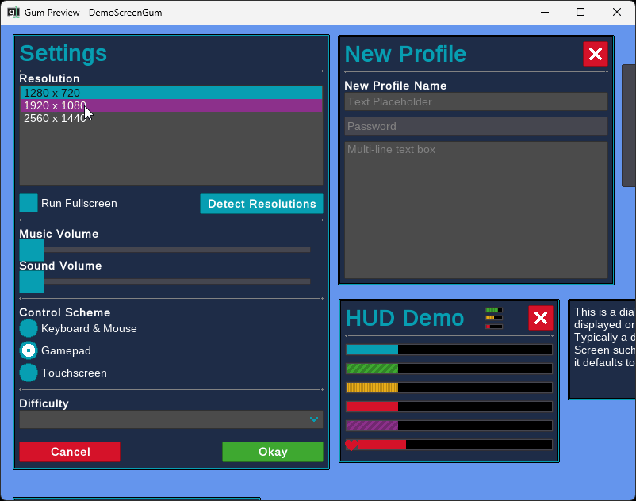<figcaption>
DemoScreenGum in the Gum preview window
</figcaption></figure>

Note that while these controls react to events, their reactions are just the built-in behaviors. For example the Detect Resolutions button does not actually have the ability to detect your screen's display adaptor's display resolutions.

The preview automatically follows your select in Gum, unless you click to pin the selection.

<figure>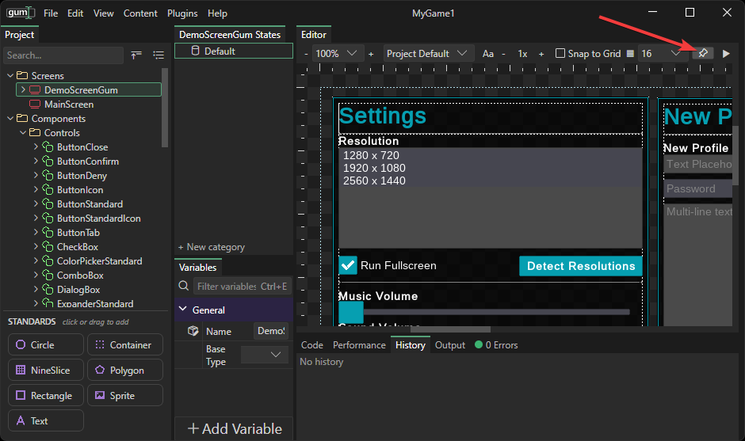<figcaption></figcaption></figure>

### Adding Instances

Instances can be added to screens and components. To add an instance:

1. Select the destination screen or component. For example, select the MainScreen.
2. Drag a Standard or Component onto the Editor tab. For example, drag **ButtonStandard** from **Components** > **Controls**.
3. Release the moue button and the instance appears in the desired location

<figure>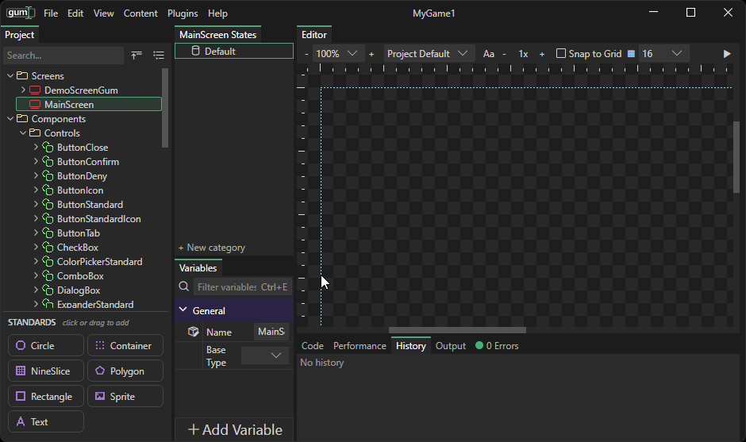<figcaption>
Adding instances by drag+dropping
</figcaption></figure>

Alternatively, you can also drag+drop onto the tree item to add instances.&#x20;

<figure>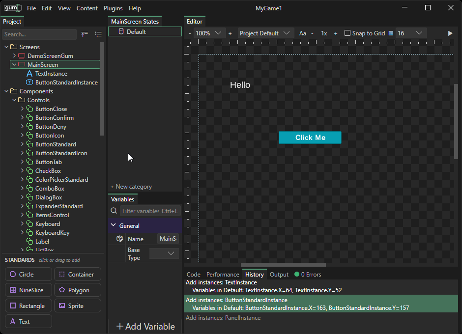<figcaption>
Drag+drop onto the screen item in the Projects tab to add a new instance
</figcaption></figure>


If an element is dropped in the Editor window, it appears at the location where it has been dropped - setting its X and Y values. If an element is dropped in the Project tab, then it preserves its default X and Y values.


### Editing in the Editor Tab

Once an instance is part of a screen or component, it can be edted visually in the preview window. The selected instance can be moved or resized with its resize handles.

<figure>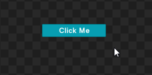<figcaption>
Editing in the Editor tab
</figcaption></figure>

### Conclusion

This tutorial introduces the Gum tool and the basics of working with Screens, Components, and Standard Elements. The next tutorial covers working with the Variables tab.
