# 2 - Variables Tab

## Introduction

The Variables tab displays the variables of the selected instance or element. When a component is selected, the values set in the Variables tab become the defaults that its instances inherit.

<figure>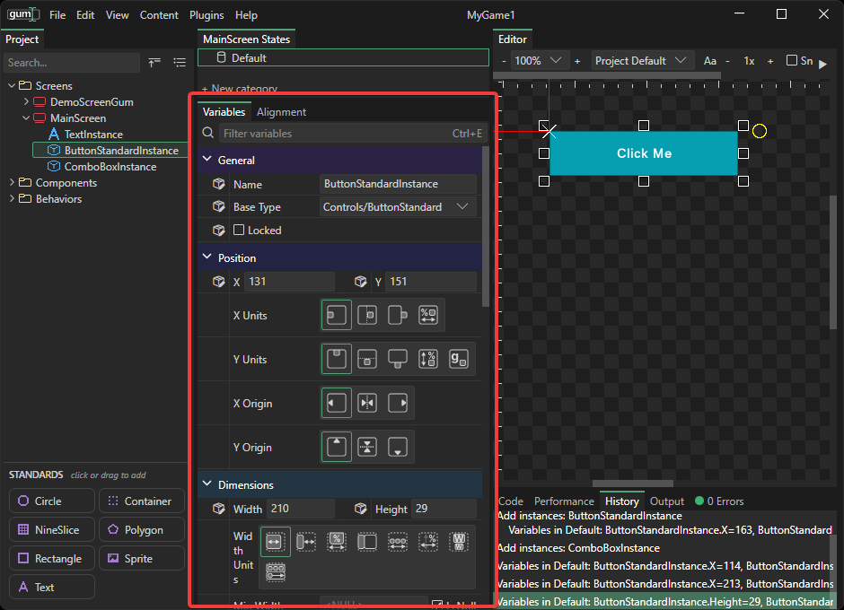<figcaption>
Variables tab in Gum
</figcaption></figure>

### Editing Variables

Variables can be edited by changing the displayed value for a given variable. Once a value is set, you can press Enter, Tab, or click outside of the text box to apply the value.

<figure>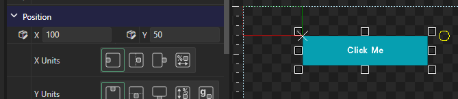<figcaption>
Editing values
</figcaption></figure>

Numerical values can also be changed by holding down the left mouse button over the variable name and dragging left or right.

<figure>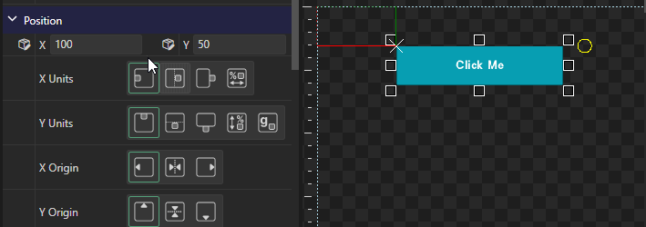<figcaption>
Dragging over a variable name to change its value
</figcaption></figure>

Variables which can be edited in the Editor tab also update in real time in the Variables tab.

<figure>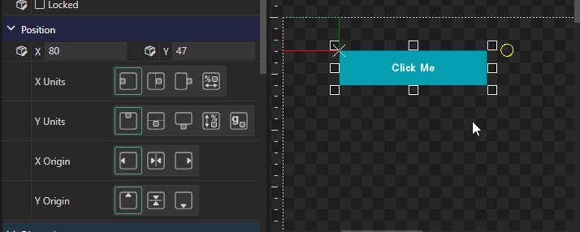<figcaption>
Editing an instance in the Editor tab updates the Variables tab
</figcaption></figure>

### Default and Overriding Values

Newly-created Gum instances inherit their variable values from their Component or Standard definition. These default values can be changed, resulting in the default value being overwritten.

For example, the ButtonStandard instance you added on the previous page has its X and Y values changed. If you resized the button, then its Width and Height are also set, overwriting their default values.

Variables which overwrite their default have a small box icon next to the label.

<figure>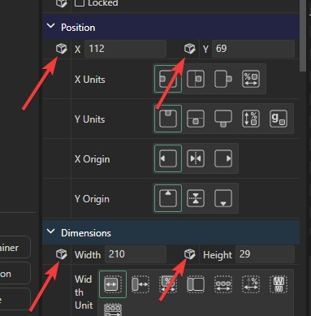<figcaption>
Values which overwrite their defaults
</figcaption></figure>

Values can be restored to their default by right-clicking on the variable and selecting **Make Default**.

<figure>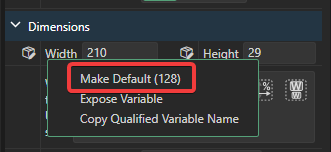<figcaption>
Right-click option to make a variable restore its default
</figcaption></figure>

For more, see [Variables](../../variables/README.md#setting-variables-to-default).

Default variables are not just a starting point - they are live references that continue to apply if the base component changes. In other words, if a variable changes on the ButtonStandard component, then these variables automatically update all ButtonStandard instances everywhere, unless the instance explicitly overrides that variable.

To see this in action:

1. Drag two **ButtonStandard** instances onto MainScreen.
2. Select the second instance and set its `Width` to a value larger than the first one's.

<figure>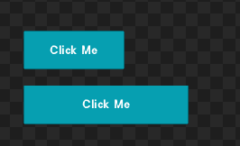<figcaption>
Two ButtonStandard instances, the second with a larger Width
</figcaption></figure>

The first button keeps the default `Width` of 128, while the second button explicitly sets its own `Width`.

3. Under **Components** > **Controls**, select **ButtonStandard** and set its `Width` to 250.

<figure>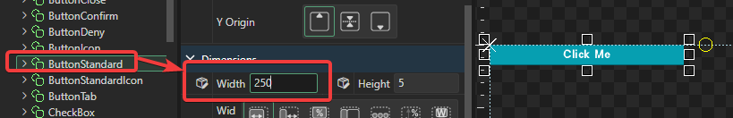<figcaption>
ButtonStandard's default value changed
</figcaption></figure>

Back on MainScreen, the first button is wider because it inherits the default, while the second button has not changed because it sets its own `Width`.

<figure>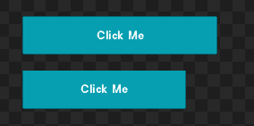<figcaption>
Width values after ButtonStandard has changed
</figcaption></figure>

Note that the Preview window can be pinned on the screen, letting you test how default value changes affect instances in realtime.

<figure>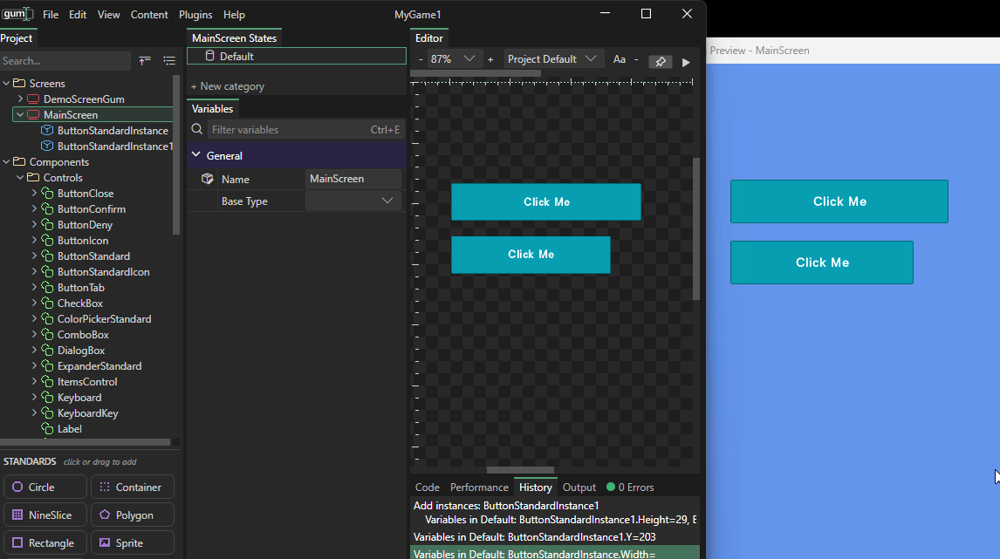<figcaption>
Preview window displaying width changes in real time
</figcaption></figure>

### Filtering and Collapsing

The Variables tab supports searching for variables by name. This filter persists across selections so you can filter down and hop between different instances when performing similar types of edits.

<figure>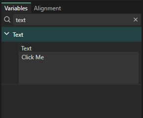<figcaption>
Variables tab displaying the Text variable, filtered by the word "text"
</figcaption></figure>

For more on filtering, see [Variables](../../variables/README.md#filtering-variables).

Similarly, categories can also be collapsed to hide their variables.

<figure>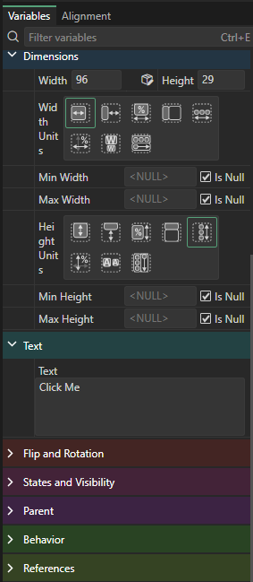<figcaption>
Categories collapsed in the Variables tab
</figcaption></figure>

Note that categories also follow a rainbow color ordering, and the same-named category is always displayed as the same color so it can be found more easily.

Some categories are specific to certain types. For example the Text category appears for Button instances, but it does not appear on the Panel type.

### Conclusion

This page shows how to work with the Variables tab, including working with default and overriding values. The next tutorial introduces parenting, alignment, and stacking layouts.
