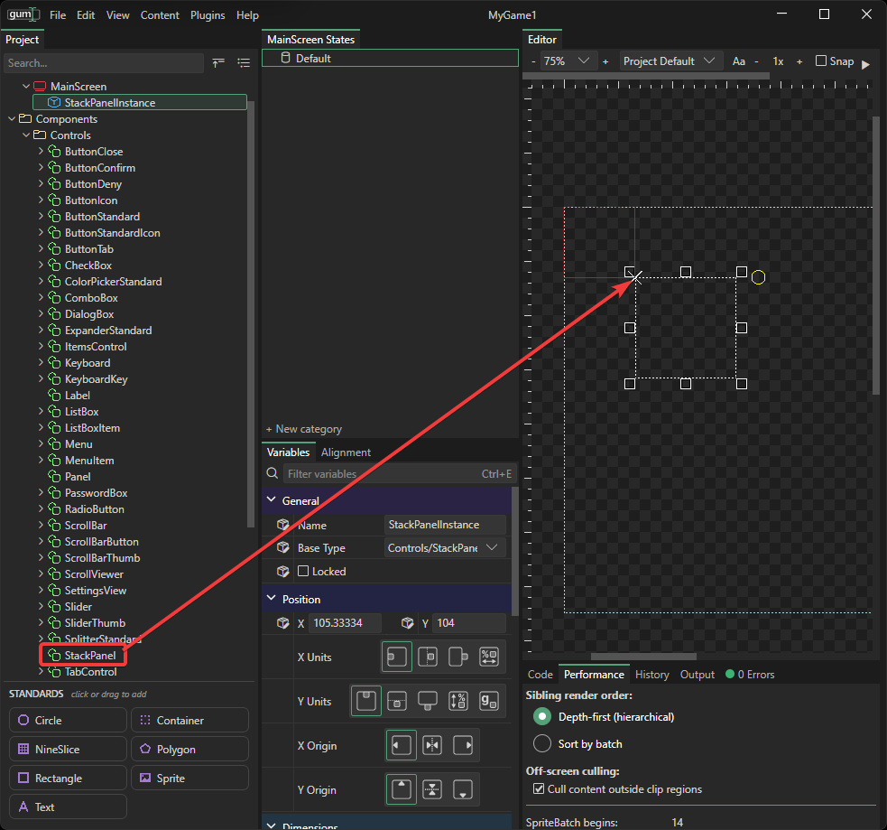
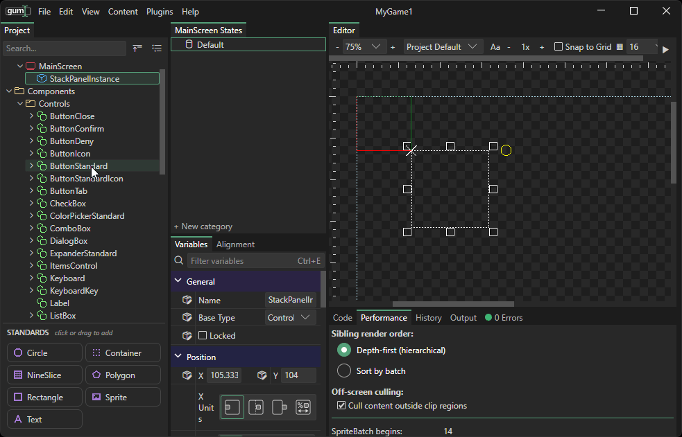
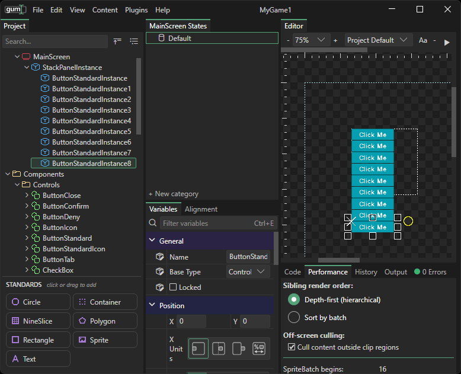
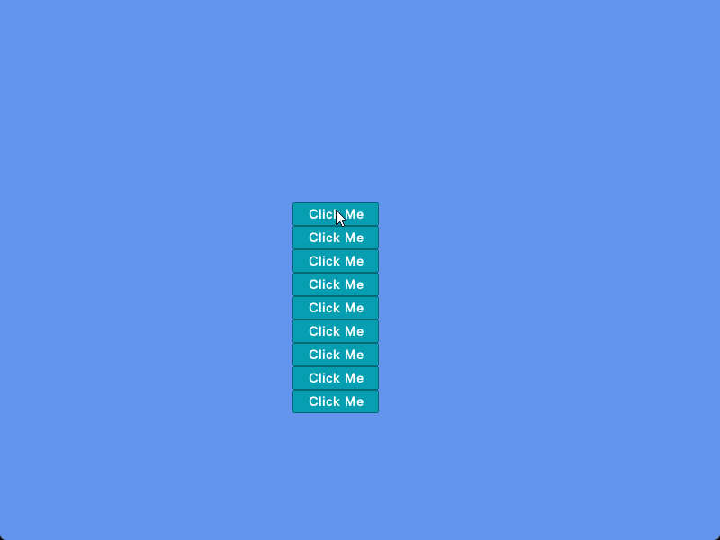
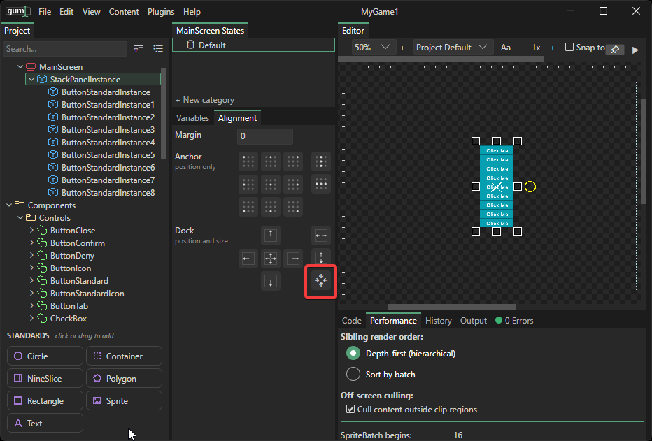
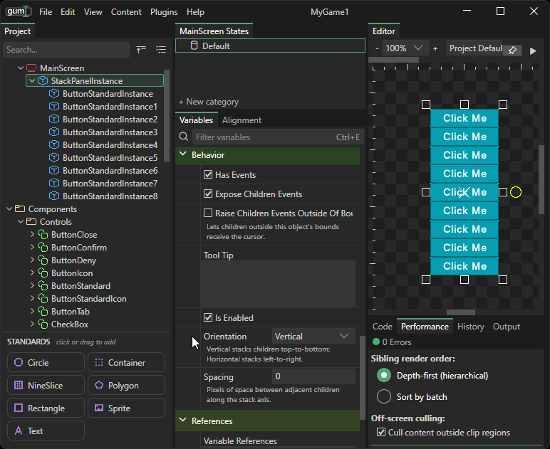
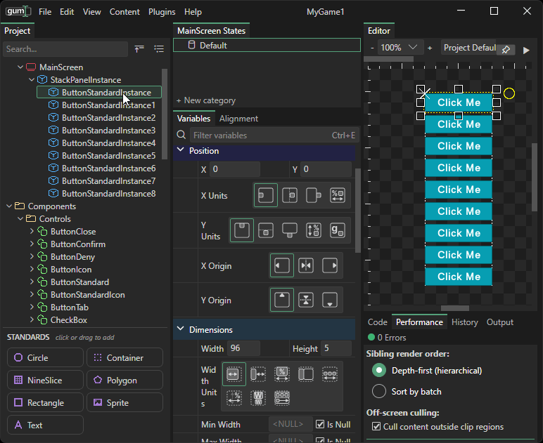
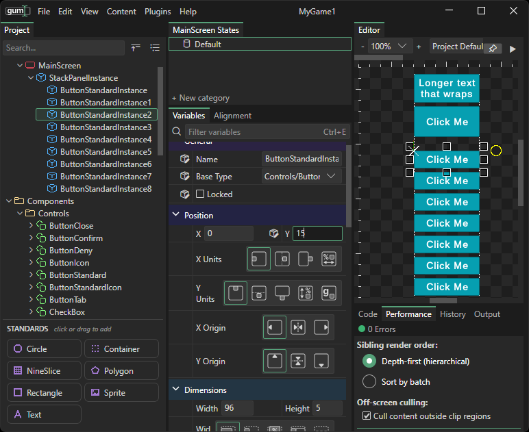

# 3 - Parent, Stacking, and Alignment

### Introduction

Although it is technically possible to align UI manually by setting X and Y values, this type of layout makes it more difficult to maintain UI or create UI that is responsive to its parents.

Gum provides parent/children relationships which can be combined with layout values to easily center, stack, dock instances.

A parent is an instance that contains other instances, called its children. When a parent moves, its children move with it. For more, see [Parent](../../gum-elements/general-properties/parent.md).

### StackPanel Control

The key to creating layouts in Gum is to add your controls to containers. Containers can be used to create stacks, grids, add margins, and move children together. The StackPanel control is one of the most common controls since it automatically stacks its children, vertically by default or horizontally when its `Orientation` is changed.

This page starts with an empty MainScreen.

1. Delete the instances that were added to MainScreen on the previous pages.
2. Drag **StackPanel** from **Components** > **Controls** onto the Editor tab.

A StackPanelInstance now appears in MainScreen.

<figure><figcaption>
StackPanel in MainScreen
</figcaption></figure>

Instances can be added to the StackPanel by drag+dropping them onto the StackPanelInstance in the tree view.

<figure><figcaption>
ButtonStandard instances added to a StackPanel
</figcaption></figure>

Additional instances can be added by selecting one of the existing buttons and pressing `CTRL+C`, `CTRL+V`.

<figure><figcaption></figcaption></figure>

### Alignment and Dock

Once a StackPanel has been created, it can be moved and its children move with it. We can use the Alignment tab to position the dock accurately. To center the dock, click the Alignment tab, and then click the Anchor Center button.

<figure><figcaption>
Centering the StackPanel
</figcaption></figure>

By default the StackPanelInstance has an absolute width and height of 150, regardless of what it contains. This presents two problems. First, the contents of the stack panel are not perfectly center aligned - buttons are left-aligned and also spill out of the bottom. Second, buttons which spill out of the bottom of the StackPanel will not receive events.

The event problem can be easily tested by launching the game and moving the mouse over the buttons. Notice that the buttons inside the StackPanelInstance receive events, while the buttons outside do not receive events.

<figure><figcaption>
Button events in Gum
</figcaption></figure>

Both problems can be solved by changing the StackPanelInstance so it resizes itself according to its children rather than using an absolute 150x150 size. To do this, click the Size to Children Dock button on StackPanel.

<figure><figcaption>
Size to Children button in the Alignment tab
</figcaption></figure>

### Spacing and Children Size

Now that the StackPanelInstance depends on its children's size, we can modify either the children or the spacing between the children and the stack panel updates automatically. To change the Stack Pacing, select the StackPanelInstance and change its Sacing variable under the Variables tab.

<figure><figcaption>
Spacing adjusts the distance between each button
</figcaption></figure>

Similarly we can adjust the size of buttons by changing their height, or adding text that wraps, and the stack adjusts dynamically, staying centered.

<figure><figcaption></figcaption></figure>

Individual button spacing can be adjusted by changing its Y value. The total spacing is the total of spacing and Y.

<figure><figcaption></figcaption></figure>

