# 4 - Control Types

### Introduction

By default Gum projects include typical controls for game UI including Button, CheckBox, TextBox, and ListBox. This page covers some of the most common types of controls and explains how to work with them. This page does not provide exhaustive coverage of all controls, so you are encouraged to explore and try them out in your own project.

Controls are added to your Controls folder under Components. Note that if you used a different theme, the folder names may differ, but most of the controls will be the same.

Label and CheckBox, which are used later in this series, are in the same folder.

<figure>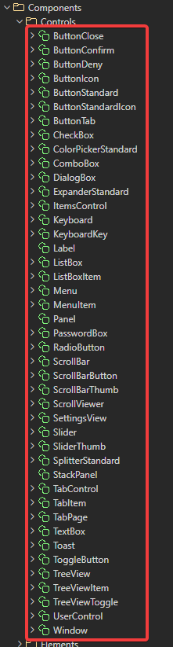<figcaption>
Controls in the Project tab
</figcaption></figure>

### Button

The ButtonStandard control is one of the most common controls. It reacts to the cursor hovering over it and clicking it.

<figure>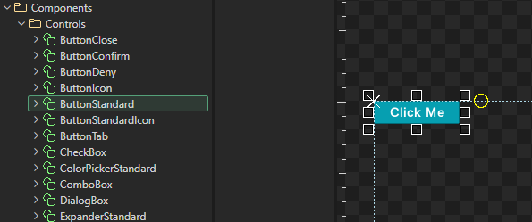<figcaption>
ButtonStandard Component
</figcaption></figure>

By default Buttons contain text that line wraps, and the height of a button is relative to its text. Adding additional text makes it wrap onto more lines, which grows the size of the button.

<figure>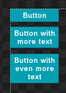<figcaption>
Buttons with different text
</figcaption></figure>

Buttons can also be disabled, which changes their appearance and makes them not respond to hover or click events.

1. Select the button instance.
2. In the **Behavior** category of the Variables tab, clear **Is Enabled**.

The button changes to its disabled appearance.

<figure>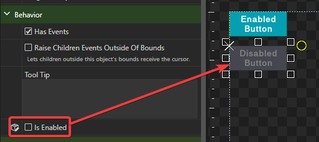<figcaption>
Enabled and Disabled button
</figcaption></figure>

### TextBox

Gum provides a fully-functional TextBox component which accepts typing, selection, copy/paste, and multi-line editing.

<figure>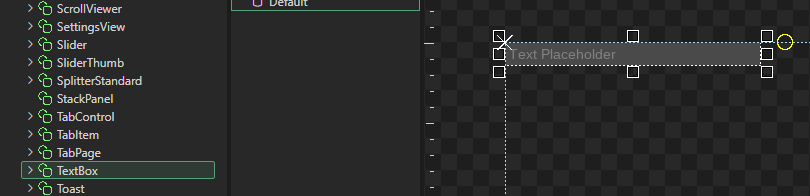<figcaption>
TextBox in Gum
</figcaption></figure>

TextBox-specific variables are all organized under the Behaviors category. TextBox has far more varaibles controlling its behavior compared to Button.

<figure>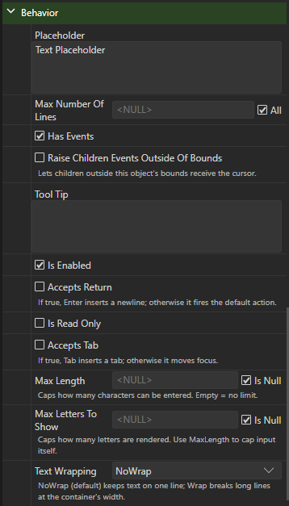<figcaption></figcaption></figure>

#### Multi-line TextBox

TextBoxes use a combination of variables to support multi-line editing. You can set any combination of these to customize how a TextBox behaves.

The Text Wrapping varaible controls whether text wraps or stays on one line. To see multi-line text easily, you may also want to adjust a TextBox's Height.

<figure>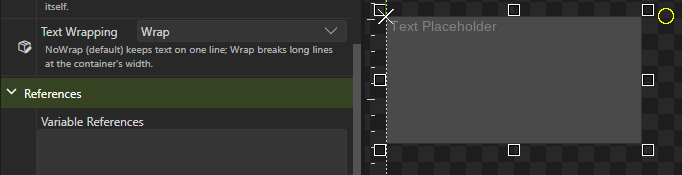<figcaption>
TextBox with text wrapping
</figcaption></figure>

You can test this behavior using Gum Preview.

<figure>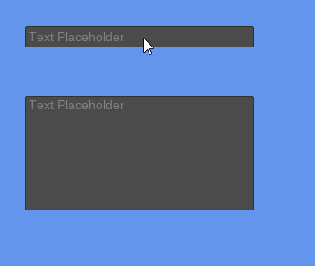<figcaption>
TextBox with wrapping
</figcaption></figure>

If Accepts Return is checked, then pressing the Enter/Return key inserts a new line.

### ListBox

ListBoxes can contain any number of ListBoxItem instances. These can be single or multi-selected. If enough items are displayed, a scroll bar appears when a game runs.

<figure>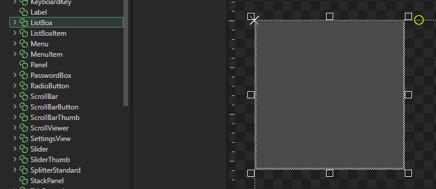<figcaption>
ListBox in Gum
</figcaption></figure>

ListBoxItem instances can be added in the tool or in game. Most of the time ListBoxes are populated in game, but Gum does support adding ListBoxItems manually.

To add items to a ListBox, drag+drop ListBoxItem instances onto the ListBox.

<figure>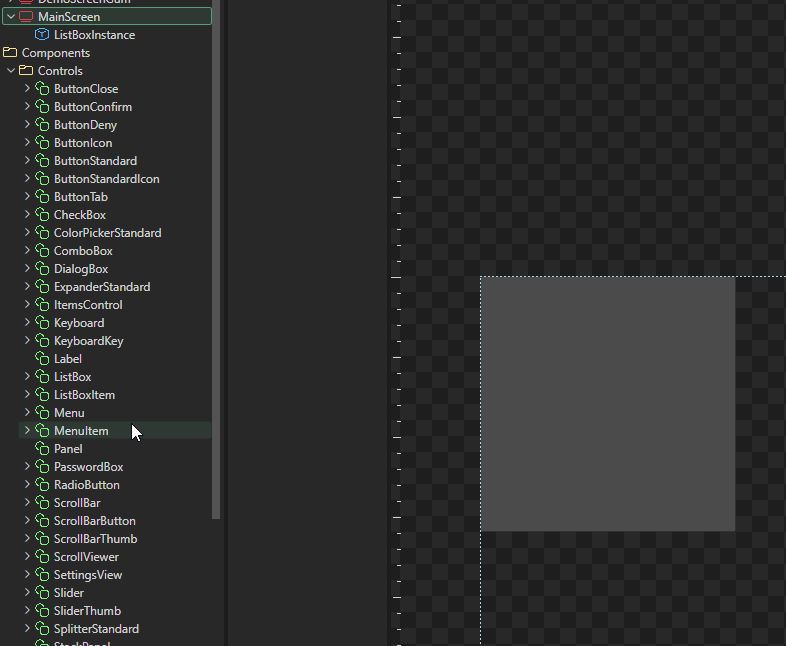<figcaption>
Adding items to ListBox
</figcaption></figure>

Each item's text can be set by selecting it and changing its Text property.

<figure>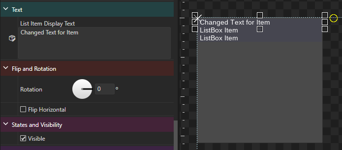<figcaption>
ListBoxItem with changed text
</figcaption></figure>

If enough items are added, then the ListBox displays a scroll bar in game.

<figure>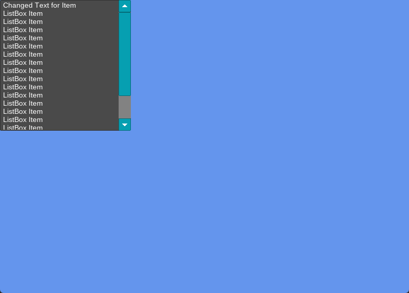<figcaption>
ListBox with a scroll bar
</figcaption></figure>

### Conclusion

This page shows how to work with some of the most common controls. As mentioned earlier, Gum has lots of controls so you'll want to try out some of the other controls in your screen and in the Preview window to get a feel for what is available.

The next tutorial discusses how to customize control appearance.
