# 5 - Customizing Control Appearance

## Introduction

The controls in a default project act as a starting point for customization. These can be fully customized. Note that the available customizations depend on the theme you selected when creating your project.

This page discusses customizing the Standard theme, but if you are using a different theme then the customization steps will be slightly different.

### Component States

Many Gum components have multiple states to control their appearance in response to cursor, keyboard, focus, or enabled actions/states. For example, the ButtonStandard component has a number of states under ButtonCategory.

For more on states and categories, see [States](../../gum-elements/states/README.md) and [Categories](../../gum-elements/states/categories.md).

You can click each of the states to see how it looks.

<figure>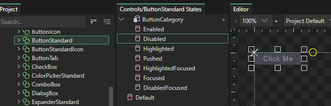<figcaption>
ButtonStandard in a Disabled state
</figcaption></figure>

Each state can set any variable on any instance. To see which variables are set by the ButtonCategory, click on ButtonCategory.

<figure>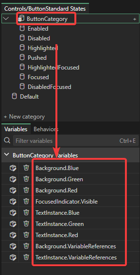<figcaption>
Variables set by ButtonCategory
</figcaption></figure>

This tells us that when the state of a button changes, the background color, text color, and focused indicator visibility are changed.

Even once we select a state like Enabled, the color value itself is read only. This is because the ButtonStandard is set to use a centralized color value, rather than explicitly setting a color value. For example, the background is set to use the Primary color in our Styles component.

<figure>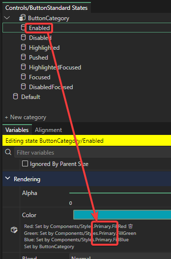<figcaption></figcaption></figure>

If we want to change the color, we can do a few things:

1. Change the color in the Styles component by selecting the instance (like Primary) in the Styles component and changing its color.
2. Change which style color is being referenced.
3. Remove the styles reference altogether and set the color directly.
4. Replace the visuals completely

Let's look at how to perform each of these.

### 1 - Changing the Styles component (Global Change)

To change colors globally, select the Styles component and find the color that you would like to change. Keep in mind that these colors may be used by many controls, so a change here can affect many controls and states.

These changes can be made while Gum Preview is open, so changes can be seen in real time. Pinning the DemoScreenGum in Gum Preview is a great way to see how these changes affect your project.

<figure>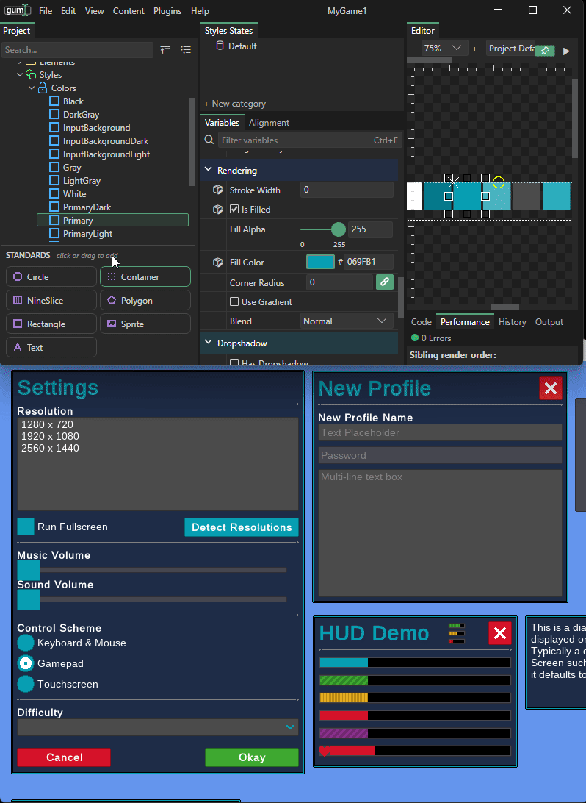<figcaption>
Changing a Styles color while Gum Preview is open
</figcaption></figure>

Each style has its own set of colors, and these colors affect different components and states in their own way, so you may need to spend some time looking at the variables on different states and test the values in Gum Preview.

### 2 - Changing Style References

Styles components come with a set of style colors built-in, and any of these can be used by your component states.

<figure>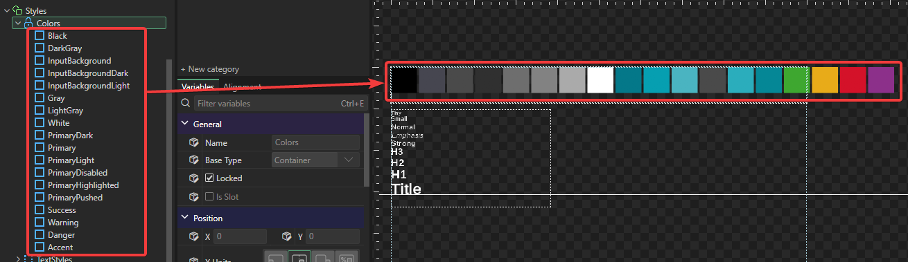<figcaption></figcaption></figure>

The colors that are used are set in variable references on component instances. For example, the background color for ButtonStandard is set in each of its states. To see the variable references, select the state, select the instance, and scroll to the bottom of the Variables tab to see the variable references.

For more on variable references, see [Variable References](../../gum-elements/general-properties/variable-references.md).

<figure><figcaption>
Variable reference on a component's instance
</figcaption></figure>

This can be edited to use a different color, such as changing from Primary to Warning.

<figure>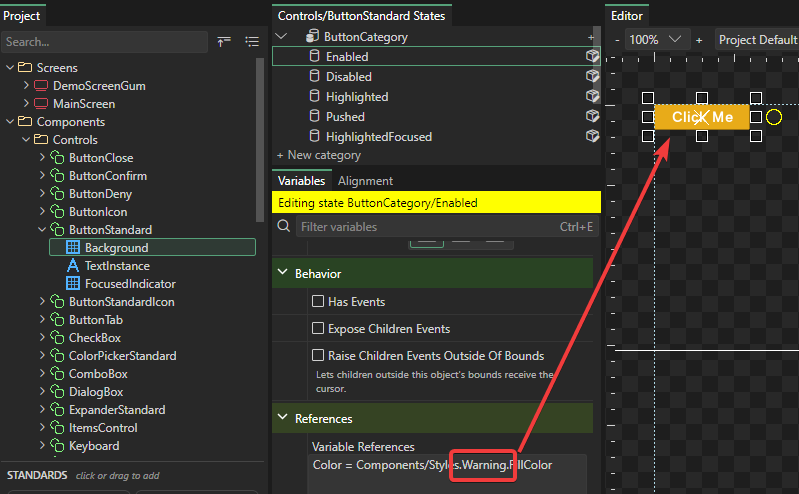<figcaption>
Variable reference using Warning
</figcaption></figure>

You're not limited to the existing style colors either. You are free to add new colors to the Styles component beyond the existing colors.

<figure>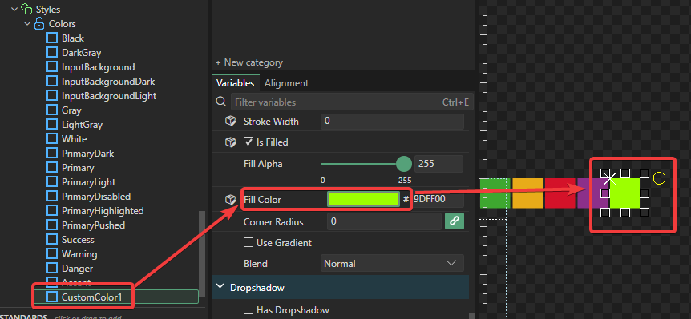<figcaption>
Custom Color in Styles
</figcaption></figure>

Once this is added, it can be referenced on any state in any component.

<figure>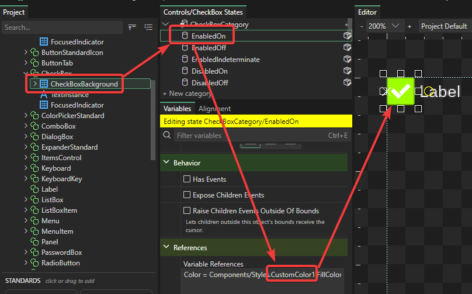<figcaption>
CheckBox using a new custom color
</figcaption></figure>

### 3 - Removing Style Color References

Style colors provide a central location for global colors, but they also add complexity to your project. If you would rather not use centralized colors, you can completely remove references altogether.

For example, to remove a style color on the TextBox's background:

1. Select the TextBox's background
2. Select the desired state
3. Scroll down to the Color value
4. Press the icon for removing variable references

<figure>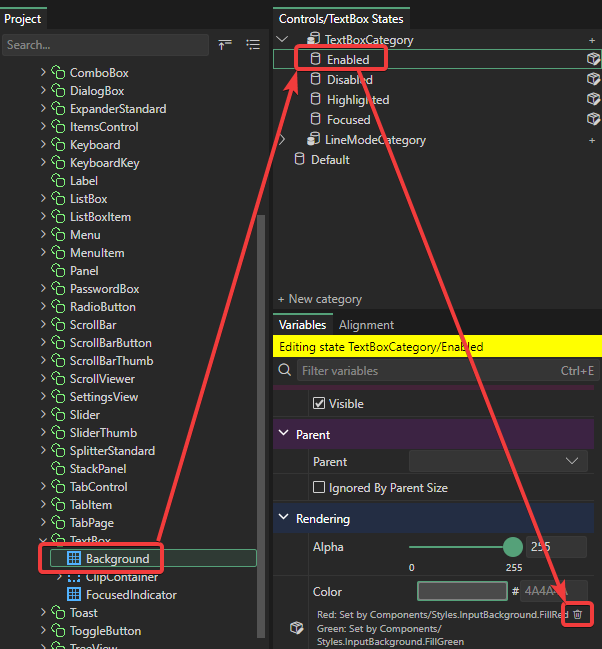<figcaption>
Removing variable references for the Enabled state on the TextBox background
</figcaption></figure>

Once this reference is removed, the color can be set directly.

<figure>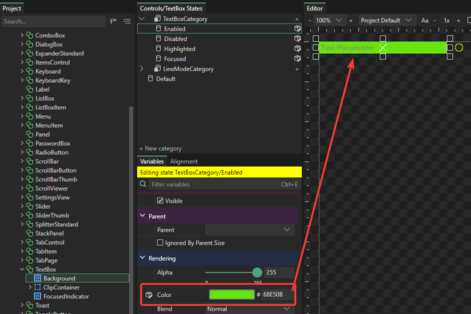<figcaption>
Direct color assignment after removing reference
</figcaption></figure>

### 4 - Replacing Visuals Completely

Visuals in components can be completely removed or replaced to customize the appearance of a component. When components are replaced, the newly-added instances in a component do not have any built-in functionality. The individual states must be set up manually (shown below).

As an example, we will replace the background of the ButtonStandard to use a rounded Rectangle rather than a NineSlice.

For more on Rectangle, see [Rectangle](../../gum-elements/rectangle.md).

First, select and delete the background on ButtonStandard.

<figure>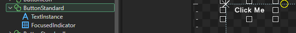<figcaption></figcaption></figure>

Next we'll add a Rectangle as a new background. To do this:

1. Drag+drop a Rectangle onto ButtonStandard
2. Drag the new RectangleInstance to place it first in the list. Items first in the list are drawn behind items last in the list.
3. Click the Alignment tab, then click **Fill** in the **Dock** group

<figure>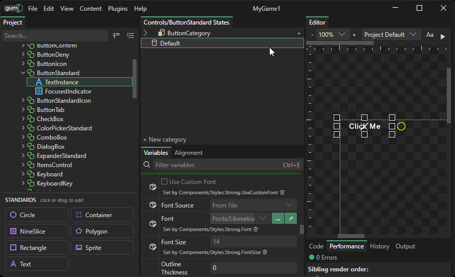<figcaption>
Adding a Rectangle to ButtonStandard
</figcaption></figure>

Now the rectangle can be customized to match the style you want for your button. For example, we can set:

* Is Filled - checked (true)
* Fill Color 0000FF (blue)
* Corner Radius 8

<figure>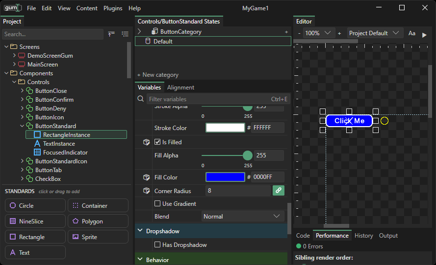<figcaption>
Button with blue fill
</figcaption></figure>

As mentioned before, since we deleted the background earlier, we need to re-wire the categories. We can do this by selecting different states in ButtonCategory and changing any value on our newly-created background.

For example, we can set the Fill Color in the Pushed state to a darker blue color.

<figure>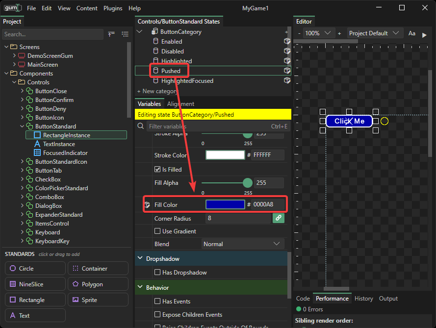<figcaption>
Darker color on Pushed state
</figcaption></figure>

Now the button should react to push state.

<figure>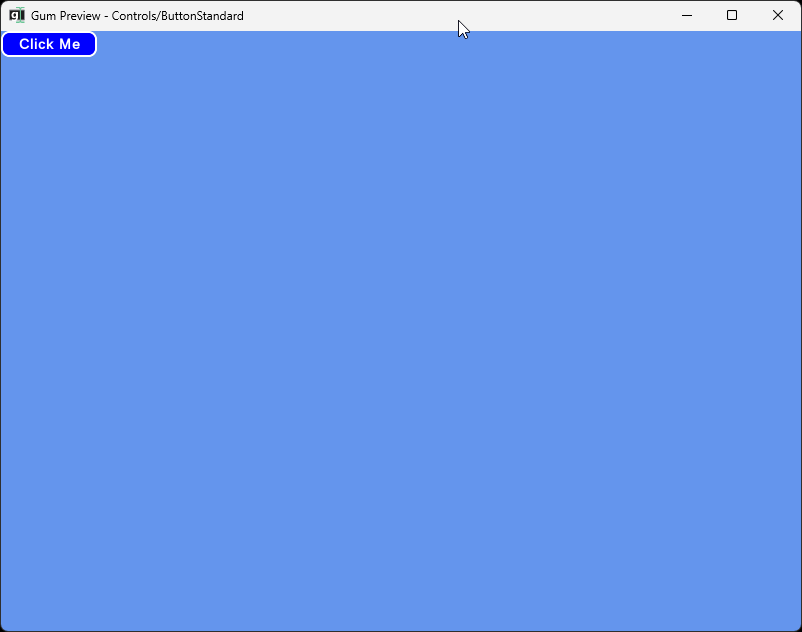<figcaption>
Pushed state in preview
</figcaption></figure>

### Conclusion

This page shows how to customize the appearance of components. The next page shows how to create brand new components.

