# 6 - Creating Custom Components

## Introduction

This document covers how to create custom components. We'll be creating a component which can be used to display player stats and apply points earned by leveling up.


This tutorial uses the default ButtonStandard. If you modified yours in previous tutorials it's okay - it should still work fine for this tutorial, but your screens and components may look a little different.


### Creating a New Component

New components can be created by right-clicking on the Components folder or any subfolder under Components.

For more on components, see [Component](../../gum-elements/component/README.md).

<figure>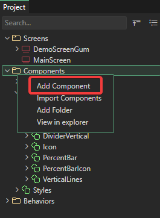<figcaption>
Add Component in the right-click menu
</figcaption></figure>

Enter the name LevelUpItem as the name and click OK.

<figure>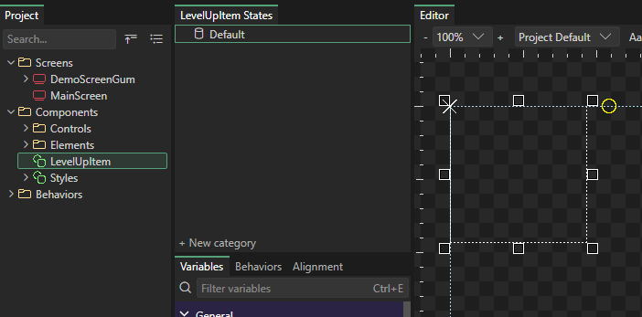<figcaption>
LevelUpItem in Gum
</figcaption></figure>

### Adding Instances to LevelUpItem

The LevelUpItem will have 3 items: 

1. A Label for displaying the stat, such as Strength
2. A Label displaying the current value of the stat
3. A button that can be clicked to assign points

First we'll add the instances before we worry about their layout. Drag two Labels and a ButtonStandard from **Components** > **Controls** into LevelUpItem.

<figure>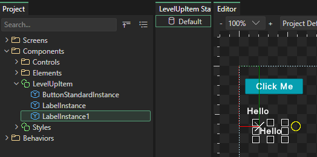<figcaption>
LevelUpItem with a button and two labels
</figcaption></figure>

Rather than leaving the default names, we can change the instances to something more expressive like StatName, StatValue, and AddPointButton.

<figure>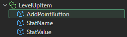<figcaption>
LevelupItem with newly named instances
</figcaption></figure>

### Adjusting Layout and Defaults

Next we'll adjust the layout of our control and its children.

First, set the values on the LevelUpItem itself by setting its:

* Width to `250`
* Height to `26`

Next, click on each of the instances and dock them as follows:

* AddPointButton: Dock Right
* StatName: Dock Left
* StatValue: Dock Right

Finally we can adjust the values for the instances:

* AddPointButton Text to `+`&#x20;
* AddPointButton Width to `26`&#x20;
* StatValue X to `-30`  so it doesn't overlap the button
* StatValue Text to `999` as a default value
* StatName Text to `<Stat Name>`&#x20;

We now have a LevelUpItem with a good setup and defaults.

<figure>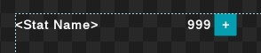<figcaption>
LevelUpItem with its default layout and values
</figcaption></figure>

### Exposed Variables

Next we'll set up exposed variables so that each instance can be independently modified. Before we create this, let's explore why exposed variables are needed.

To understand the need, we can create a screen with 2 LevelUpItem instances. These 2 instances can differ by setting their "top level" variables. In other words, we can change their positions, sizes, and visibility. However, we cannot change the `<Stat Name>` or `999` values. Those are properties that belong to the Text instances contained within each LevelUpItem.

This is intentional - if it didn't work this way, then the LevelUpItem would expose every property of every contained item, which would be an overwhelming number of variables to deal with. Instead, variables that belong to instances in a component are _hidden_ unless explicitly exposed.

We can solve this by picking which variables we want to expose so that they can be set per LevelUpItem instance.

First, we'll expose the variable to replace `<Stat Name>` . To do this:

1. Select the StatName instance inside LevelUpItem
2. Right-click on the Text variable
3.  Select Expose Variable 

    <figure>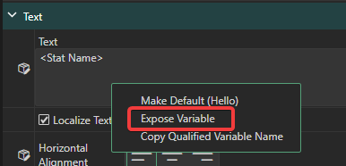<figcaption>
Expose Variable right click item
</figcaption></figure>
4. Enter the desired name, such as `Stat` . Notice that you cannot have an exposed variable that matches the name of your instance, so StatName is an invalid variable name.

Repeat this by exposing the `Text` variable on StatValue, creating a variable named `Value` . Also, repeat this by exposing the AddPointButton's `Visible` variable, naming it `IsAddPointVisible` .

After you're finished, these variables should show up if you select the LevelUpItem component.

<figure>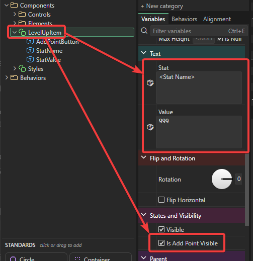<figcaption>
Exposed variables shown on the component
</figcaption></figure>

Now that we have these exposed variables, we can also customize them per-instance in a screen.

<figure>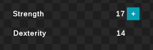<figcaption>
Two LevelUpItem instances with different exposed variable values
</figcaption></figure>

### Hiding Variables

Gum also supports hiding variables at the component level. Hiding variables makes it easier to work with component instances by only displaying variables which should be modified for each instance.

For more on hiding variables, see [Hide from Instances](../../variables/hide-from-instances.md).

For example, some variables may not make much sense to expose, such as the Children Layout variable on a LevelUpItem. After all, we have determined a very specific layout of our children, and we don't want each instance to change this.

Similarly, some properties might just be considered noise that we can remove, such as `Rotation` and `Flip Horizontal` - these are variables which may be useful in some situations, but we may decide that our game never needs them.

We can right-click on any variable in the LevelUpItem to hide it.

<figure>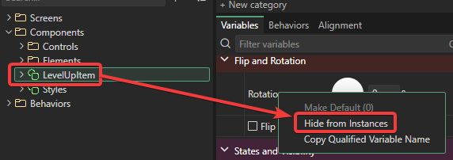<figcaption>
Hide from Instances right-click item
</figcaption></figure>

By removing all of the variables that we never intend to change, we can make it much easier to work with a LevelUpItem instance.

<figure>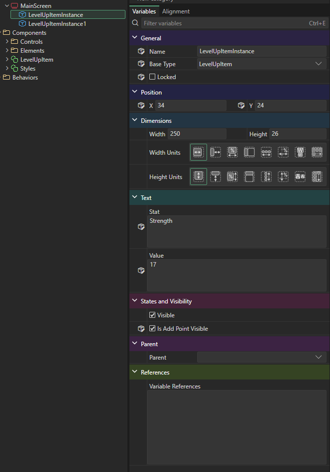<figcaption>
LevelUpItemInstance only displaying some variables - other variables have been hidden
</figcaption></figure>

Note that hiding a variable from instances does not hide it at the component level - all variables are still available there and can still be given defaults that all instances use.

Hidden variables are also labeled as hidden with a small label under each variable.

<figure>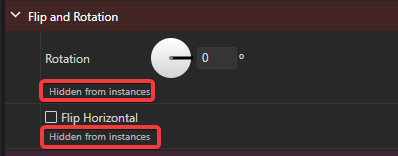<figcaption>
Hidden Variables on a component display a label
</figcaption></figure>

### Conclusion

This tutorial shows how to create a simple component with explicitly exposed variables along with hidden variables. This covers the concepts of creating a component, but components can be anything that you might want to encapsulate or reuse. It's best to spend some time creating new components or modifying the LevelUpItem component that we created to become more familiar with how components work.

To use the screens and components you create in a game, continue with the [Gum UI Tool and Code Tutorial](../../../code/getting-started/tutorials/gum-project-forms-tutorial/README.md).

For more on working in the Gum tool, see [Gum Elements](../../gum-elements/README.md), [Variables](../../variables/README.md), and [States](../../gum-elements/states/README.md).

If you have questions, or want to show what you are building, join the [Discord chat](https://discord.gg/EvqwmSQuBz).
