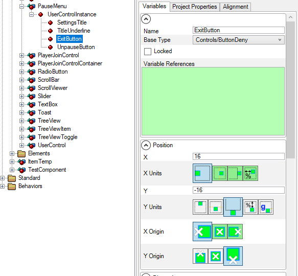
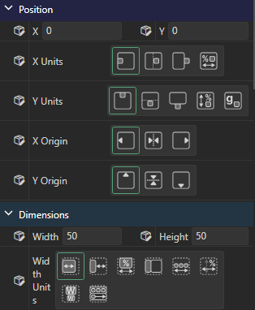
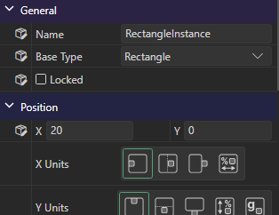
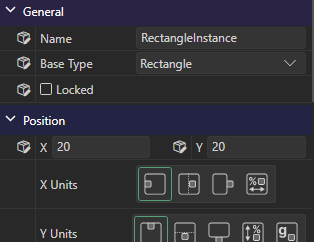

# Variables

## Introduction

The Variables tab displays the variables for the currently-selected element, instance, or behavior. The variables tab displays the effective value of all variables for the selected object and provides controls for changing these variables.

<figure><figcaption>
Variables for the ExitButton instance
</figcaption></figure>

## Filtering Variables

An element can have more variables than fit on screen, so a filter box sits above the variable list. Type in it and the tab shows only the variables whose name contains what you typed. Matching ignores capitalization, so typing `vis` finds `Visible`.

Matching variables stay inside their own categories, which means a filter also shows you where a variable lives. Categories holding no matches hide while you are filtering, and clearing the filter restores every category, including which ones you had expanded.

Press `Ctrl+E` from anywhere in Gum to bring the **Variables** tab forward and put the cursor in the filter box. Press `Escape` to clear the filter and move focus back to the variable list, or click the **X** button at the right of the box.

## Default and Explicitly Set Values

A variable which is explicitly set at the current selection level has a small box icon next to its label. A variable without the icon is not set, so it inherits its value from the next level down.

Standard elements explicitly set their values on their Default state, so every variable shows the icon. The following image shows the Rectangle standard element.

<figure><figcaption>
All values explicitly set on a Rectangle standard element
</figcaption></figure>

By contrast, if a Rectangle is dropped into a Screen or Component, this creates an instance. Most of its variables on the instance are not explicitly set, so they have no icon. For example, in the following image `X` is the only Position variable that is set on the instance. `Y` and the unit variables inherit their values from the Rectangle standard element.

<figure><figcaption>
Only X is set in Position, so only X has the icon there
</figcaption></figure>

If a variable is set, then its value is updated and the icon appears. Variables can be set by typing in values, clicking on icons, dragging over the labels, or changing the value in the editor tab.

<figure><figcaption>
After setting Y, the icon appears next to Y
</figcaption></figure>

## Setting Variables to Default

A changed variable can be restored to default.

Any change can be undone with the CTRL+Z key combination if the variable was previously set to its default value. The undo history can be viewed in the History tab which updates as changes are made or as undo's are applied.

<figure><figcaption>
If a variable was previously its default value, an undo restores the default value
</figcaption></figure>

Variables can be set to default by right-clicking on the variable in the Variables tab and selecting the **Make Default** option.

<figure><figcaption>
Make Default right click option restores a variable to its default value
</figcaption></figure>

